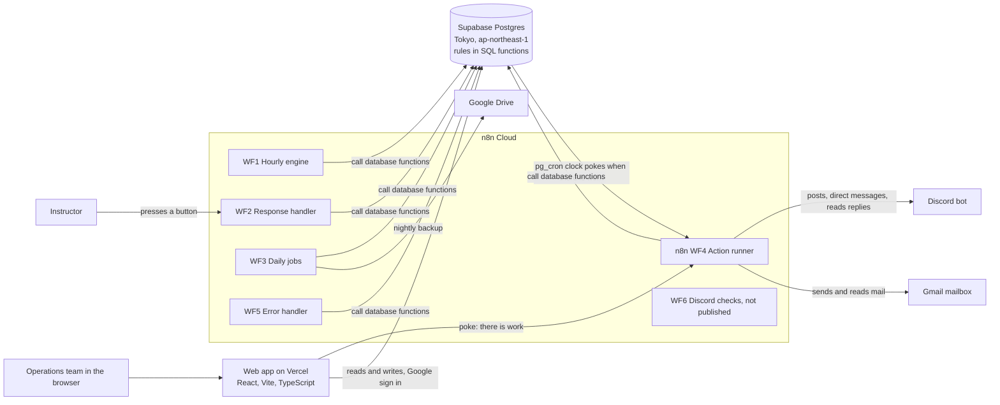

# SME Scheduling

SME Scheduling is the scheduling and outreach platform of the operations team. It plans class weeks for every domain,
cohort and module, asks instructors to teach in order (the Primary instructor first, then the backups) by Discord and
email, and follows each class week through to the day it is taught. There are no double bookings and no "sorry,
someone else got it" messages. Everything it does is written to Activity history.

The live app is <https://your-app.vercel.app>. There is one environment, **Production**.

Contents: [What the app does](#what-the-app-does) · [Architecture](#architecture) · [Features](#features) ·
[Business rules and edge cases](#business-rules-and-edge-cases) · [Database structure](#database-structure) ·
[Integrations](#integrations) · [Environment setup](#environment-setup) · [Deployment](#deployment) ·
[Sign in and admins](#sign-in-and-admins) · [Discord setup](#discord-setup) ·
[Backups and rollback](#backups-and-rollback) · [Testing](#testing) · [Troubleshooting](#troubleshooting) ·
[Maintenance](#maintenance) · [For the operations team](#for-the-operations-team) · [Docs](#docs)

## What the app does

- **Plans classes.** A domain (a program area, for example Backend) has modules, cohorts and class times. The team
  plans class weeks for a cohort by hand or from a standard schedule. A class week is the classes of one module taught
  by the same instructor.
- **Asks instructors in order.** About 30 days before a class week (the default), the app asks the Primary instructor
  in the module's instructor order, by a post in their Discord channel and by email. If they say no or do not answer
  in time, it reminds them, then asks Backup 1, then Backup 2, one person at a time.
- **Confirms and reminds.** The first valid Yes confirms that instructor. They get a confirmation, then reminders
  before class where they can answer All set, Need help or Can't make it.
- **Handles changes.** Releases and replacements, time changes, times an instructor proposes, breaks, cohort
  holidays, shared classes, cohort merges, standard and custom schedules, cancellations and restores.
- **Tells the team what needs a person.** Tasks show on Home under Needs your attention. Team alerts go to the
  domain's Discord alert channel, with direct messages or email to the people concerned.
- **Shows everything.** The Schedule board shows every cohort's class weeks with their status and problems, and
  Activity history shows every change, message and answer. Nobody can edit or delete Activity history.

## Architecture

Three parts. The database holds every rule; n8n only moves messages in and out; the web app writes only to the
database.



### Database (Supabase)

- **Postgres 17 on Supabase**, project `abcdefghijklmnopqrst`, region Northeast Asia (Tokyo, `ap-northeast-1`), on
  the free plan.
- **All business rules are SQL functions** in `supabase/migrations/`. Asking, confirming, releasing, moving, every
  schedule check and every message text are decided there. The app's buttons and n8n call the same functions, so the
  same rules always apply.
- **Row level security** on every table. Only people allowed to sign in can read or change data, checked on every
  request.
- **The database clock.** `pg_cron` runs the automatic check inside the database (`sme-engine-hourly`, minute 30)
  and a job every 2 minutes (`sme-clock`) that calls WF4 through `pg_net` only when there is work. See
  [Integrations](#integrations).

### n8n (Cloud)

Six workflows, named `[Production] WF1 Hourly engine` to `[Production] WF6 Discord checks` in n8n. The exported files
of the live workflows are in `n8n/sandbox/` (an internal folder name). They hold no business rules and no domain,
module or instructor names.

| Workflow             | When                                                                                                                        | What it does                                                                                                                                                                                                  |
| -------------------- | --------------------------------------------------------------------------------------------------------------------------- | ------------------------------------------------------------------------------------------------------------------------------------------------------------------------------------------------------------- |
| WF1 Hourly engine    | Not published since 23 November 2026: the database clock runs the same check (runs only if someone runs it by hand)         | Runs `engine_tick_all`, the automatic check for every domain. The database clock runs the same check itself every hour                                                                                        |
| WF2 Response handler | Webhook, when an instructor opens an answer link                                                                            | Shows the answer page (`response_page`) and records the answer only when the button on the page is pressed (`submit_response_page`)                                                                           |
| WF3 Daily jobs       | Every day at 09:00 IST                                                                                                      | Runs `daily_jobs` (the daily system summary) and saves the nightly backup to Google Drive, keeping the newest 30                                                                                              |
| WF4 Action runner    | Webhook (a poke from the database, within seconds of any queued message or Discord check) and a safety run every 15 minutes | The only place messages are sent: delivers queued Discord and Gmail messages, runs app actions and the Discord checks people asked for, and reads typed replies (see [Gmail through n8n](#gmail-through-n8n)) |
| WF5 Error handler    | When another workflow fails                                                                                                 | Records the failure in Activity history and alerts the admin channel                                                                                                                                          |
| WF6 Discord checks   | Not published                                                                                                               | Off, kept as a spare. WF4 does the Discord checks                                                                                                                                                             |

n8n runs on the owner's n8n Cloud Pro plan: 10,000 executions a month, shared with the other workflows in the same n8n
account. Since 23 November 2026 the database clock does WF1's work (WF1 is not published) and WF4 runs on pokes plus a
safety run every 15 minutes. WF2, WF3 and WF5 do not change. There is one workflow set: edit the base files in `n8n/`, run
`npm run n8n-export -w scripts`, then import or update the live workflow from `n8n/sandbox/` (n8n/README.md).

### Web app

- **React, Vite and TypeScript** in `app/`, hosted on Vercel's free Hobby plan at <https://your-app.vercel.app>.
  `vercel.json` holds the build settings. Cloudflare Pages is the free alternative the app already supports.
- **Pages:** Home, Schedule board (`/board`), Upcoming classes (`/classes`), Instructor requests (`/requests`), Setup
  (Domains, Modules, Standard schedules, Instructors, Team), Settings (Automation, Messages, Testing, Connections,
  Admin), Activity history (`/activity`) and Help (`/help`).
- **In app Help** with step by step guides and pictures, written in `app/src/help/*.md`.
- Every page sits in its own error boundary: if one page fails, only that page shows "This page could not be shown"
  with Try again.

### Internal names that keep the word Sandbox

The old Sandbox was renamed Production on 22 November 2026; the same Supabase project, n8n instance and Vercel app
became Production. Some internal names keep the word Sandbox on purpose, because renaming them could break working
integrations or links already sent. They are internal names only, not a second environment:

- n8n credentials `Gmail Sandbox`, `Discord Bot Sandbox`, `Supabase Sandbox` and `Poke Secret Sandbox` (and
  `Google Drive Backups`)
- the n8n tag `Sandbox`
- the webhook paths `/webhook/sandbox-respond` (answer pages) and `/webhook/sandbox-sme-poke` (the WF4 poke)
- the folder `n8n/sandbox/` (the one workflow set, the live workflows; `n8n/production/` and its generator option
  were removed on 23 November 2026, decision 315)
- the files `.env.sandbox.example`, `app/.env.sandbox.example` and `app/.env.sandbox`, and the command
  `npm run dev:sandbox`
- `npm run configure:sandbox -w scripts`, kept only to roll back the switch to Production
- the database's environment value `Sandbox` and the unused function `reset_sandbox_data`, active only under that
  rollback

Nothing people see in the app says Sandbox, demo or test environment; the wording scan refuses those words.

## Features

| Area                      | What you can do                                                                                                                                                                     |
| ------------------------- | ----------------------------------------------------------------------------------------------------------------------------------------------------------------------------------- |
| Home                      | A Get started list while the app is not set up, then Needs your attention (tasks, urgent first), summary cards and this week's classes                                              |
| Schedule board            | By cohort, By instructor and List views; one status per cell with colour, icon and word; exception badges; Needs a decision counts as filters; Compare to standard; bulk actions    |
| Upcoming classes          | Every class week with its time zone, region, status and instructor; Plan classes, Add one class, Download as spreadsheet; the class week drawer with every action                   |
| Instructor requests       | Who is being asked for each class week; Ask the next instructor, Start asking now, change the order, ask a specific person, assign and confirm, record a phone or chat confirmation |
| Setup, Domains            | Domain status (Draft, Testing, Live, Paused), Discord server and alert channel, teams, class types, holidays, cohorts and regions, breaks, cohort holidays and merges               |
| Setup, Modules            | Class times, instructor order (Primary, Backup 1, Backup 2), owners and operations team, with versions per cohort; Who we ask next                                                  |
| Setup, Standard schedules | Named standard schedules per domain (tracks) with module order, class times and break weeks; plan up to 20 cohorts at once; Reset to standard; Update cohorts                       |
| Setup, Instructors        | One record per person across domains: email, Discord username, a channel per domain, contact check, dates they cannot teach, classes a month, test instructors                      |
| Setup, Team               | Team members, job titles, Discord usernames, Remove access and Give access back                                                                                                     |
| Settings                  | Automation (timing per domain or cohort), Messages (templates with preview), Testing (practice clock, practice class, Go live), Connections (health, servers, Usage), Admin         |
| Activity history          | Every change, message and answer with who did it; filters, search, Undo for safe edits, Download as spreadsheet                                                                     |
| Archive and delete        | Archive and restore domains, cohorts, modules and Discord servers; a permanent delete shows what it affects first and asks for the name                                             |

## Business rules and edge cases

All of these are enforced in the database, so the screen can never save what the database would refuse.

### Asking in order

- The instructor order of a module (optionally a different order for one cohort) is Primary, Backup 1, Backup 2 and
  so on. A Chosen list picks people by hand for one class week.
- **Only one request is open per class week at a time**, and the first valid Yes confirms. Nobody else is asked after
  that.
- Instructors who are not in use, unavailable on those dates, busy at that time, already declined this class week, or
  whose contact details are not checked (in a live domain) are skipped, each with the reason shown.
- No answer: a reminder, then the request closes politely and the next person is asked. The closer the class, the
  shorter the wait ("close to the class" is 10 days and "very close" 3 days by default).
- Nobody left to ask: the class week shows Needs an instructor, with an urgent task.
- **Default timeline:** setup check 45 days before, asking 30 days before, owner check 14 days before, reminders before
  class 10 and 2 days before, then marked completed after the last class. The numbers are on Settings, Automation per
  domain or cohort. Changes apply only to what is not yet sent.
- **Typed replies never change a booking.** A reply typed in Discord or email becomes a task; a person decides.
- **No message is sent twice.** Each message has a unique key and is written before it is sent; a message the
  automation took but never reported back is not sent again.

### The sooner class first

Nobody has two open requests for classes that overlap in real time (UTC), across cohorts, domains and regions. The
class week whose first class is sooner gets the instructor first; on a tie, the cohort that started first, then the
cohort's name. A later class week skips them with "Being asked for a sooner class" and asks its next instructor. A
confirmed booking is never taken away. The clock handles requests sooner classes first and reads each request as it
is now, so a request withdrawn earlier in the same run is never reopened or marked No reply (decision 340).

### Time zones and regions

- Each cohort has a region: **US** (US Pacific, PST or PDT) or **India** (IST). Each class can be switched to the
  other zone on its own. Changing a cohort's region does not move classes already planned.
- Classes are stored in UTC and converted with the named time zone, never a fixed offset. A 9:00 AM class stays at
  9:00 AM local time after a clock change.
- Every class time ends with its zone; a US class also shows the India time. Activity history shows your own time
  zone.
- When US clocks move forward, times between 2:00 AM and 3:00 AM do not exist and are blocked. When they move back,
  times between 1:00 AM and 2:00 AM happen twice and the app asks which one you mean.
- Instructor messages go as soon as they are ready, at any hour (decision 332). Quiet hours for instructors are an
  optional domain setting, off by default; when on, they follow the instructor's own time zone, else the class's.
  Every time in an instructor message is shown in US Pacific and India time. Team quiet hours do not change.
- A Draft domain never creates or sends instructor messages; going back to Draft cancels what is waiting (decision 333).
- A class week never shows Waiting for an answer with nobody asked: the usual next step runs when a change is saved
  and on every clock run (decision 332). A withdrawn instructor is not asked again for that week (decision 333).

### Holidays and cohort holidays

- Holidays are added per domain, for US classes, India classes or both. A class on a holiday is a Warning.
- A **cohort holiday** is one day off for one cohort only. A class on it is a Warning with the fixes: move it, cancel
  it, or Keep with a reason (saved in Activity history).

### Breaks and program breaks

- A **break** moves every class week of a cohort from its first day back by whole weeks; each class keeps its local
  time and later breaks move too. A **program break** is the same break for every cohort of a domain, shown as one row.
- Blocked: a start in the past or inside a class week that has started, a class week that starts before the first day
  with classes after it, an overlap with another break, and a confirmed instructor who would clash or be unavailable
  (tick Release to let them go and ask the next instructor).
- Each confirmed instructor gets one message for all their moved class weeks and answers Still works or Doesn't work
  for each.

### Shared classes

- One class week is the host: it keeps the class, its one booking and its messages. The other cohorts' class weeks
  join as guests, follow its times and are never asked or messaged themselves.
- Blocked: started, cancelled, finished or already shared class weeks, the same cohort, a different number of
  classes, different times without choosing whose to keep, and a clash for the host's instructor. Different modules,
  odd hours in any cohort's time zone, holidays and a tight gap are Warnings.
- Stop sharing gives a cohort its own class week back and asks its instructor order.

### Cohort merges

- Two or more cohorts continue as one combined cohort from a merge date, which must be the first day of a class week,
  after every cohort has started and not in the past. The operations team chooses the name, time zone, module
  sequence and instructor order.
- Duplicate modules: the week with a confirmed instructor is kept. Two different confirmed instructors are a Warning;
  the other one gets the release note unless the operations team keeps that cohort's week instead. The **Merge
  check** lists modules that do not line up.
- Undo merge is possible until the merge date.

### Proposed times

- A request to teach and a time change message have **Propose another time**. Nothing confirmed changes until the
  operations team decides, and the reply time is extended by up to 48 hours.
- The operations team sees the proposal checked with every schedule check. A clash or unavailable date blocks it;
  other problems are Warnings. Accepting moves the classes for the whole cohort and confirms the person being asked
  (or keeps a confirmed instructor confirmed). Rejecting tells them the time stays.
- A moved class shows **Moved** with its old time, and "Waiting for the instructor to confirm the new time" until a
  confirmed instructor answers.

### Clashes and unavailable instructors

- An instructor can never teach two classes at the same moment, in any cohort, domain or region. A database exclusion
  rule on booked time slots is the final protection.
- Assigning someone busy, moving a class onto another of their classes, or a Yes that now clashes is refused with the
  other class, its cohort and both local times.
- Unavailable dates block asking and assigning; the person is skipped for class weeks in that range.

### Block, Warning with a reason, Information

Every save, preview, fix and the Schedule board use one shared check (`week_problems`, `schedule_problems`).

| Level       | Meaning                                            | Examples                                                                                                                                                                                                                                                   | Fixes offered                                                                      |
| ----------- | -------------------------------------------------- | ---------------------------------------------------------------------------------------------------------------------------------------------------------------------------------------------------------------------------------------------------------- | ---------------------------------------------------------------------------------- |
| Block       | Cannot be saved                                    | Clash, unavailable instructor, a time that does not exist, a break or move that creates a clash                                                                                                                                                            | Move the class, ask the next instructor, release and ask the next, share the class |
| Warning     | Saved only with a reason, kept in Activity history | Holiday, cohort holiday, class in a break, odd hours (before 6 AM or from 10 PM), overlapping classes in a cohort, tight gap (under 30 minutes), full day (more than 2 classes), monthly limit, instructor not in use, different modules in a shared class | Move, cancel, keep with a reason                                                   |
| Information | Shown, no reason needed                            | Short notice, sooner class first, a proposed time waiting, a shared class                                                                                                                                                                                  | None needed                                                                        |

The limits are settings in Planning on Settings, Automation, changeable per domain. A Block always comes before any
Warning.

### The beta guard on who may receive messages

Set by admins on Settings, Admin, and checked for every recipient and every tag when a message is queued and again
when n8n takes it to send:

- **Who may receive email:** only the listed email domains (yourcompany.com during the beta).
- **Who may receive messages:** "Test instructors and signed in colleagues" during the beta, or "Anyone". With the
  beta setting, only test instructors are contacted, a Discord direct message goes only to a team member who has
  signed in, and a message may only tag such accounts.
- Every blocked message is cancelled (not failed) and logged with its reason. "Anyone" with an empty email list
  restores the full Production rules after the beta.
- Discord posts also need a server an admin approved for that domain (see [Discord setup](#discord-setup)).

### Pause all messages

Admins can stop every message to instructors at once from the account menu, Settings, Automation or Settings,
Connections. Requests stop moving on, team alerts still go out, waiting messages are kept, and a red bar shows on every
page. **Turn messages back on** sends the waiting messages once each at the next automatic check. To stop one domain,
set its status to Paused; to stop one class week, use Pause requests. A confirmed class week cannot be paused.

### The daily email cap

At most 1,000 emails in any 24 hours by default (an admin can set up to 2,000 on Settings, Admin). At the cap, emails
wait instead of being cancelled, Discord messages still go out, one task a day says so, and the database clock does
not call n8n for emails that must wait.

### Other rules

- Test instructors are for trying things out. In a live domain they are asked only while the beta setting is on;
  with "Anyone" they are never asked or booked there.
- A domain in **Testing** sends every message only to its testing channel and testing email, with a practice clock.
- Two people saving the same record: the second sees "This changed, reload". Class weeks change only through
  database functions that lock the week, so a second conflicting action is refused with a reason.
- A message the automation took 15 minutes ago without saying whether it was sent is never sent again by itself: it
  shows as **Check needed**, the team gets a task, and chooses **It arrived, mark as sent** or **Send again**
  (decision 341).
- Cancelling a class week withdraws open requests and tells a confirmed instructor. A permanent delete can never be
  undone; Undo is for edits only.

## Database structure

### Schemas

- **`public`**: every table and the functions the app and n8n call through the Supabase API. Row level security is on.
- **`private`**: internal helper functions (the engine steps, eligibility, clash and holiday checks, message routing,
  the clock). It is not exposed through the API.
- Supabase's own `auth`, `cron`, `net` and `vault` schemas hold sign in, the clock jobs, web calls and the poke key.

### Main tables and how they relate

| Group     | Tables                                                                                                                                       | How they relate                                                                                                                                                                                                            |
| --------- | -------------------------------------------------------------------------------------------------------------------------------------------- | -------------------------------------------------------------------------------------------------------------------------------------------------------------------------------------------------------------------------- |
| Programs  | `domain`, `cohort`, `module`, `class_type`, `class_pattern_item`, `holiday`                                                                  | A domain has cohorts (each with a region) and modules; a module has class times (`class_pattern_item`), optionally per cohort                                                                                              |
| People    | `team_member`, `domain_team`, `module_owner`, `module_operations`, `instructor`, `instructor_email`, `instructor_unavailability`             | One instructor record per person across domains; owners and operations teams per domain, module or cohort                                                                                                                  |
| Order     | `module_ranking`, `manual_queue_item`                                                                                                        | The instructor order per module, optionally per cohort; a Chosen list per class week                                                                                                                                       |
| Schedule  | `module_week`, `class_session`                                                                                                               | A class week (`module_week`) belongs to a domain, module and cohort and holds its classes (`class_session`, stored in UTC with a region)                                                                                   |
| Asking    | `request`, `response_link`, `booking`, `booking_slot`                                                                                        | Requests ask one instructor for one class week; a booking confirms one; `booking_slot` has the exclusion rule that stops overlapping bookings                                                                              |
| Release 3 | `standard_schedule` (with `_module`, `_break`, `_class`), `cohort_break`, `program_break`, `cohort_holiday`, `time_proposal`, `cohort_merge` | Standard schedules per domain; a cohort points to its standard; breaks, holidays, proposals and merges point to cohorts and class weeks; `module_week.shared_with` and `class_session.shared_class_id` link shared classes |
| Work      | `attention_item` (tasks), `reminder`, `help_request`, `checklist_item` (class tasks), `action_queue`                                         | Tasks and help requests point to class weeks; app buttons queue actions for WF4                                                                                                                                            |
| Messages  | `message`, `message_template`                                                                                                                | Every message in and out with its unique key and status                                                                                                                                                                    |
| Discord   | `discord_server`, `discord_channel`, `discord_server_domain`, `instructor_channel`, `discord_cursor`                                         | Servers the bot is in, their channels, which domains an admin approved, and each instructor's channel per domain                                                                                                           |
| System    | `app_config`, `system_state`, `setting_definition`, `setting`, `history_event`, `app_error`, `beta_access`, `clock_state`, `n8n_usage`       | App links and beta settings, Pause all, settings per domain or cohort, Activity history (append only), the beta list, the clock and the n8n run counter                                                                    |

### Migrations and rollback files

- `supabase/migrations/` holds 80 migrations, applied in file name order. The latest definition of a function is in
  the last migration that creates or replaces it.
  - `20261110*`: the first build (tables, engine, pages, actions)
  - `20261111*`: Release 1 (people and cohorts, flexible classes, access, audit, environments)
  - `20261112*` and `20261113*`: Release 2 and the core round (time zones, Discord, notifications, review fixes)
  - `20261122*`: Release 3 (baseline fixes, the database clock, admins, the beta guard, server approval, the schedule
    checks, standard schedules, breaks, proposed times, shared classes, merges, the Schedule board, Usage, connection
    tests, trusted bounces, the domain server picker, bulk actions)
  - `20261123*` and `20261124*`: the beta recipients and database pokes, the High live fixes, messages at any hour,
    the Draft rule, the r3-m6 merge (status words, setup, channels, Contact instructor), the clock's current rows,
    Check needed and faster lists (decisions 329 to 342)
- `supabase/rollback/` has one rollback file for every Release 3 migration (46 files, same names). Each is proved by
  `npm run check-rollbacks -w scripts`.
- `supabase/seed.sql` sets only the sender name; the app starts empty. `supabase/seed.local.sql` is for your own
  computer only and runs with `npm run db:reset`.
- `supabase/tests/database/` holds the pgTAP tests (75 files, `010` to `750`), and `supabase/tests/fixtures/` the test
  data for the end to end and scale tests.

To understand a rule, search the migrations for its function name (for example `confirm_booking` or `week_problems`)
and read the last file that defines it; docs/DECISIONS.md explains why each rule is the way it is.

## Integrations

### Discord bot

- One bot, connected in n8n with the credential `Discord Bot Sandbox`. It needs exactly four permissions: View
  Channels, Send Messages, Embed Links and Read Message History, plus the Server Members Intent and Message Content
  Intent.
- The bot can be in several servers. A new server waits for an admin's approval and the bot does nothing there until
  then (only its name and ID are recorded). Each server is checked a few at a time and shows Ready or Needs a fix.
- Instructor messages go to the instructor's channel in the class's domain, tagged, plus email; without a channel, a
  direct message plus email. The confirmation also tags the owners and the operations team. Team alerts go to the
  domain's alert channel. Link previews are switched off.
- Typed replies are read only from the instructors' own channels, and only messages written by that instructor.
- Channels can come from any approved server. Username searches and direct messages of a domain use its one main
  server.

### Gmail through n8n

- Email is sent and read with the n8n credential `Gmail Sandbox` (n8n's own Sign in with Google), from the team's
  mailbox. No Gmail client secret or refresh token is needed.
- Every system email carries a Reply To address of its own (the +scheduling address), and WF4 reads only replies to
  it and bounces of emails the app sent; the rest of the shared inbox is never touched. It labels what it handled
  "SME Scheduling/Processed" and does not mark it as read.
- A bounce counts only when it is in the Gmail thread of an email the app sent to that address; any other "bounce"
  is logged as ignored.

### The database clock poking WF4

- `sme-clock` runs every 2 minutes and calls WF4 only when there is work: a message waiting to be sent, a queued app
  action or Discord check, or an open conversation (something sent to an instructor in the last 3 days) whose replies
  were last read 10 minutes ago or more. At most one call a minute.
- Reply reading slows to every 20 minutes above 8,000 n8n runs this month and stops on its own above 9,300 (every WF4
  run still reads replies, and messages still go out).
- `sme-engine-hourly` runs the automatic check inside the database at minute 30 of every hour.
- The poke key is kept in Supabase Vault (`n8n_poke_key`), never in a file or in the app. The database pokes WF4
  within seconds of any queued message or Discord check, so the app itself never calls n8n (decision 334).
- `sme-run-log-purge` keeps the clock's run log to the last 7 days, every night at 21:15 UTC (decision 333).
- Typed replies show in the app within about 10 minutes.
- The clock has been on since 22 November 2026, 17:36 UTC. Since 23 November 2026, 12:48 UTC (owner), WF1 is
  unpublished (the database's hourly job does its work) and WF4 runs on pokes plus a safety run every 15 minutes.
- `npm run clock -w scripts -- status` shows the clock, its jobs, whether the poke key is in Vault (yes or no only) and
  the n8n runs this month. `off` switches it off at once; then turn the schedule triggers of WF1 and WF4 back on and
  publish both again.

### Google Drive

WF3 uploads `sme-backup-YYYY-MM-DD.json` every night with the credential `Google Drive Backups` and moves backups older
than the newest 30 to the Drive bin.

## Environment setup

### What you need

- **Node.js 22** and npm, and **Docker Desktop** (for the local Supabase stack).
- The **Supabase command line** comes with the repository (`supabase` in the root `package.json`); every command runs
  through npm, so `npx supabase` is never needed.
- **On Windows**, the folder name contains `&`: copy `.npmrc.windows-example` to `.npmrc` first, so npm scripts run in
  Git Bash.

### Run it on your own computer

```bash
npm ci
npm run db:start
```

`db:start` starts the local Supabase stack (ports 5542x) and prints its address and keys. Copy `app/.env.example` to
`app/.env.local`, fill in the local address and publishable key it printed, and set `VITE_ALLOWED_EMAIL_DOMAIN` to
`example.com` and `VITE_ENABLE_DEV_LOGIN` to `true`. Then:

```bash
npm run dev
```

Open <http://localhost:5173> and sign in with any `@example.com` address; the sign in link arrives in the local mail
catcher at <http://127.0.0.1:55424>. The local app starts empty: follow the Get started list on Home.

### npm commands

| Command                                                          | What it does                                                                |
| ---------------------------------------------------------------- | --------------------------------------------------------------------------- |
| `npm run db:start`, `npm run db:stop`                            | Start or stop the local Supabase stack                                      |
| `npm run db:reset`                                               | Rebuild the local database from the migrations and `seed.local.sql`         |
| `npm run dev`                                                    | The app at <http://localhost:5173> against the local stack                  |
| `npm run check`                                                  | Format check, lint, types, unit tests, build and the production build check |
| `npm run lint`, `npm run typecheck`, `npm test`, `npm run build` | Each check on its own                                                       |
| `npm run format`                                                 | Format every file with Prettier                                             |
| `npm run db:test`                                                | Every database test on throwaway databases                                  |
| `npm run mock`, `npm run mock -- --race`                         | The mock journey, with the race checks                                      |
| `npm run e2e`, `npm run e2e:scale`                               | The end to end suite and the scale test, in their own test stack            |
| `npm run help:screenshots`                                       | Make the pictures of the in app Help again                                  |
| `npm run scan-text -w scripts`                                   | The wording scan                                                            |
| `npm run check-migrations -w scripts`                            | Build a throwaway database from every migration and the seed                |
| `npm run check-rollbacks -w scripts`                             | Prove every Release 3 rollback file                                         |
| `npm run n8n-export -w scripts`                                  | Build the one workflow set in `n8n/sandbox/` from the base files in `n8n/`  |
| `npm run test-list -w scripts`                                   | List every scenario from the test files (for docs/TEST_REPORT.md)           |
| `npm run db:login`, `npm run db:link`, `npm run db:push`         | The Supabase command line for the hosted project                            |
| `npm run backup -w scripts -- --label <name>`                    | Back up and verify the live database                                        |
| `npm run clock -w scripts -- status`                             | The database clock (`on` and `off` too)                                     |
| `npm run admins -w scripts -- list`                              | List admins (`add <email>` and `remove <email>` too)                        |
| `npm run configure:production -w scripts`                        | Write the environment, sign in domain and app links into the live database  |
| `npm run discord:production -w scripts`                          | Run the Discord checks from your computer instead of n8n                    |

The commands that touch the live database (`backup`, `clock`, `admins`, `configure:production`, `discord:production`)
read `.env.production`, the live settings file on your computer. It is ignored by Git and never committed.

### Settings files

- **`.env.example`**: every setting the scripts read, explained. Copy it to `.env.production` for a new setup.
- **`.env.sandbox.example`** (internal name): the Production values that are not secret. Copy it to
  `.env.production`, add the database connection string (`DATABASE_URL`, with your password) and set `APP_BASE_URL`
  to `https://your-app.vercel.app`.
- **`app/.env.example`**: the app against the local stack. **`app/.env.sandbox.example`** (internal name): the app on
  your computer against the live database, with `npm run dev:sandbox`.
- docs/CONFIGURATION.md lists every value, whether it is secret and where it goes. Secrets go only into Supabase,
  n8n, Vercel or your local `.env.production`, never into the repository or chat.

## Deployment

Every change is built and fully tested locally first, and nothing new is deployed without the owner's OK.
docs/PROGRESS.md says which changes are live.

1. **Test locally:** `npm run check`, `npm run db:test`, `npm run check-rollbacks -w scripts`,
   `npm run mock -- --race`, `npm run scan-text -w scripts` and the full `npm run e2e`.
2. **Pause all messages** if the change touches sending or the engine.
3. **Back up and verify** (Docker Desktop must be running):

   ```bash
   npm run backup -w scripts -- --label before-<change>
   ```

4. **Database.** Link once with `npm run db:link -- abcdefghijklmnopqrst`, then list what would be applied, check it
   is exactly the new migrations, and push:

   ```bash
   npm run db:push -- --remote --dry-run
   npm run db:push -- --remote
   ```

   Without `--remote`, `db:push` goes to the local database.

5. **n8n.** Change the base files in `n8n/`, run `npm run n8n-export -w scripts`, and update each changed workflow in
   n8n from `n8n/sandbox/` (never edit the exported files by hand). n8n keeps each workflow's previous version.
   Publish it, then run it once. n8n/README.md has every step, including credentials and the Config node.
6. **App.** Deploy from the repository folder with the Vercel command line:

   ```bash
   npx vercel@65.14.0 deploy --prod
   ```

7. **Live checks** on <https://your-app.vercel.app>: sign in, Home loads with no console errors, Settings,
   Connections shows Working or Ready, `npm run clock -w scripts -- status` looks right, and the n8n executions of
   WF4 (and of WF1 while its schedule trigger is on) succeed. Then the checks for the change itself.
8. **Turn messages back on** if you paused them. If anything fails, roll back first, then fix locally (see
   [Backups and rollback](#backups-and-rollback)).

## Sign in and admins

- **Google sign in only**, through Supabase Auth, with a company Google Workspace account (yourcompany.com).
  Email sign in is switched off. The hook `hook_before_user_created` refuses accounts outside the company domain and
  records the attempt.
- **Who may sign in** is either "Allowed email domain" or "Beta list" (the beta setting; live: "Beta list", 5 people
  on 24 November 2026). It is checked on every
  request, so taking someone off the list locks them out at once. A refusal is in Activity history.
- **The beta list** is on Settings, Admin. Only addresses at the company domain can be on it.
- **The first sign in** adds the person to the Team page by itself and asks once for their Discord username.
- **Admins** are all equal. Only admins manage the beta list and who may sign in, who may receive messages and the
  daily email cap, Discord server approvals, Pause all messages, the app links and admin alert channel on Settings,
  Connections, settings for every domain, Remove access, and the tests on Connections. This is checked in the
  database, not only hidden on the screen.
- Any admin can make another signed in person an admin, or remove admin rights, on **Settings, Admin**. The last admin
  cannot be removed. Every change is logged with who made it.
- From the command line (reads `.env.production`):

  ```bash
  npm run admins -w scripts -- list
  npm run admins -w scripts -- add <email>
  npm run admins -w scripts -- remove <email>
  ```

  These follow the same rules and are logged as "Setup command".

## Discord setup

1. **Invite the bot.** On Settings, Connections, Discord servers, press **Open the invite link** and add the bot to
   the server. The link asks for the four permissions only. The link is built from `VITE_DISCORD_CLIENT_ID` (the
   Application ID, not a secret).
2. **Give the bot access** to the category of the instructors' channels (often `1-1`): Edit Category, Permissions, add
   the bot's role with the same four permissions. Do the same for private alert, admin and testing channels.
3. **Approve the server.** An admin presses **Refresh servers**, then **Approve** next to the new server and chooses
   the domains that may use it. Admins can also press **Approve for this domain** in Setup, Domains. Refuse and Remove
   access are there too; removing access marks the domains that used it "Needs a fix" with one task each, and email
   still goes out.
4. **Choose the server and alert channel** on Setup, Domains: open the domain, choose its **Discord server** (only
   servers approved for that domain are listed), then its **Alert channel**. Wait for **Ready**; Needs a fix says what
   to change.
5. **Choose the admin alert channel** on Settings, Connections (admins), for failures and the daily system summary.
   Choose the testing channel on Settings, Testing.
6. **Instructors:** on Setup, Instructors, type each instructor's **Discord username** (without @). The app finds the
   account and shows **Discord found**. Then open them again and choose their channel under **Their channel in each
   domain**. The alert, testing and admin channels cannot be an instructor's channel.
7. **Team members:** a Discord username is optional; people without one get email.

Nobody types Discord IDs into the app: servers and channels are chosen from lists and people are found by username.

## Backups and rollback

- **Nightly:** WF3 saves a backup of every setup and schedule table to Google Drive (the newest 30 are kept).
  Activity history can also be downloaded as a spreadsheet.
- **Before every change to the live database:**

  ```bash
  npm run backup -w scripts -- --label before-<change>
  ```

  It refuses any project but `abcdefghijklmnopqrst`, dumps the whole database (structure and data) to a dated file
  outside the repository, restores it into a local throwaway database, compares the row count of every table and saves
  the comparison next to the backup. It only reads the live database. The poke key in Vault is not in a dump; keep it
  in the password manager.

- **Roll back first, then fix locally:**
  - **App:** `npx vercel@65.14.0 rollback` brings back the previous deployment in seconds.
  - **n8n:** restore each changed workflow's previous version from its version history and publish it.
  - **Database:** pause all messages, run the migration's file from `supabase/rollback/` against the live database,
    and remove the migration's row from `supabase_migrations.schema_migrations` so it can be applied again after the
    fix.
  - **Last resort:** restore the backup taken before the deploy. Anything done since is lost, so pause all messages and
    tell the testers first.
  - **The clock:** `npm run clock -w scripts -- off`, then publish the schedule triggers of WF4 and WF1 again.
- docs/RUNBOOK.md has every step.

## Testing

| What                  | Command                                   | Notes                                                                                                                                                             |
| --------------------- | ----------------------------------------- | ----------------------------------------------------------------------------------------------------------------------------------------------------------------- |
| Database tests        | `npm run db:test`                         | pgTAP, every file in `supabase/tests/database/`, on throwaway databases built from the migrations. One file: `npm run db:test:scratch -w scripts -- <file>`       |
| Migration check       | `npm run check-migrations -w scripts`     | Every migration and the seed apply cleanly                                                                                                                        |
| Rollback check        | `npm run check-rollbacks -w scripts`      | For each rollback file: migration, rollback, migration again, with a schema fingerprint after each                                                                |
| Unit tests            | `npm test`                                | Vitest in `app/`                                                                                                                                                  |
| All app checks        | `npm run check`                           | Format, lint, types, unit tests, build and the check that the production build has no development sign in                                                         |
| Mock journey          | `npm run mock`                            | The real engine through a full class week timeline, printing every message n8n would send, with no accounts                                                       |
| Race checks           | `npm run mock -- --race`                  | The same Yes pressed from two connections makes one booking; two class weeks asking the same instructor at once give one request, to the sooner class             |
| Integration rehearsal | `npm run integration:rehearse -w scripts` | The real journey on the local test stack, with the script standing in for n8n                                                                                     |
| End to end suite      | `npm run e2e`                             | Playwright in its own local test stack (ports 5552x, app on 5174), never the app database                                                                         |
| Scale test            | `npm run e2e:scale`                       | 60 cohorts, 160 instructors and 1,560 class weeks; each main page and the Schedule board must show its data within 8 seconds                                      |
| Wording scan          | `npm run scan-text -w scripts`            | The rules in docs/GLOSSARY.md: no dashes or hyphenated words on screen, no internal names (outside Connections), and no Sandbox, demo or test environment wording |

**The end to end projects** (`e2e/playwright.config.ts`): page tests at desktop 1440, laptop 1280, tablet 768 and
phone 390, each light and dark (`desktop-light` to `mobile-dark`, run four at a time); `crawl-desktop` and
`crawl-mobile`, which click every enabled control on every page; `scenarios`, the scenario files in `e2e/tests/`; and
`scale`, only with `npm run e2e:scale`. Console errors, failed requests, serious axe problems, sideways scrolling,
overlapping or cut off controls and dashes on screen all fail a test. The full run takes a few hours; while working,
run one project or test with `npm run e2e -- --project=scenarios -g "<title>"` (add `--keep` to keep the test stack
for quick reruns). docs/TEST_REPORT.md lists every scenario.

## Troubleshooting

docs/RUNBOOK.md has a table of common problems with the likely cause and what to do: no daily system summary, an old
automatic check, messages that stay waiting, buttons that do not send at once, failed Discord messages, bounced
emails, answer links that do not work, someone who cannot sign in, "This changed, reload", requests that do not start,
"Needs an instructor" and written replies.

**Settings, Connections** shows a status for Discord and Email:

| Status                 | Meaning                                                                                                |
| ---------------------- | ------------------------------------------------------------------------------------------------------ |
| Working                | The last message went out                                                                              |
| Ready, no messages yet | Set up, but nothing was sent yet. This is normal after setup                                           |
| Not set up             | A step is missing, and the line says which (for example an approved server or the admin alert channel) |
| Problem                | The last attempt failed after the last message that went out, with the reason and what to fix          |

Admins see **Send a test** on Discord and Email: Discord posts to the admin alert channel and Email sends to the
admin's own address, at most one a minute each, logged in Activity history. Connections also shows when the
automatic check last ran, messages waiting to send, the errors people ran into in the app, and Advanced: links.

After an outage nothing needs replaying: the next automatic check catches up, missed reminders go out once, and
nothing is sent twice.

## Maintenance

- **Free plan limits** (docs/FREE_TIER_LIMITS.md): Supabase free (500 MB database, 2 free projects, a project pauses
  after a week without use, which the clock prevents), Vercel Hobby (non commercial use; Cloudflare Pages is the free
  alternative), Gmail (the daily email cap), Discord (rate limits only) and n8n Cloud Pro (10,000 executions a month).
- **The Usage view** on Settings, Connections (admins only) shows the database size against 500 MB, emails in the last
  24 hours against the cap, n8n runs this month by workflow against 10,000, and messages by channel.
- **n8n executions:** the app counts only its own runs, and the 10,000 are shared with the other workflows in the
  same n8n account, so n8n's own count on its dashboard can be higher. `npm run clock -w scripts -- status` shows the
  count from the command line.
- **Deferred items** are in docs/DEFERRED.md, for example fallback channels per instructor and a daily check of saved
  instructor channels, both after the beta.
- **Adding a domain** needs no code: follow the Help guide Setting up a new domain.

## For the operations team

This part is for the people who use the app every day. The full guide is in the app: press **Help** in the sidebar,
or the **?** next to any page title.

### Every day

1. Open **Home**. Look at **Needs your attention**. Urgent tasks are at the top.
2. For each task, press **I'm on it**, do what it says, then press **Mark done**.
3. Open the **Schedule board**. Look at **Needs a decision** at the top. Press a count to see only those class weeks.
4. Check your domain's alert channel in Discord.

### Where to look

- **Home:** what needs you today.
- **Schedule board:** every cohort and week at a glance, with problems marked.
- **Upcoming classes:** every class, its time and its instructor.
- **Instructor requests:** who is being asked right now.
- **Activity history:** what happened, who did it and when.

### Common problems and what to do

| You see                           | What to do                                                                                                                                        |
| --------------------------------- | ------------------------------------------------------------------------------------------------------------------------------------------------- |
| Needs an instructor               | Phone people. Then open the class week and press **Assign and confirm instructor**, or add instructors to the module's order                      |
| A written reply                   | Read it and decide. Press **Reply** to answer the instructor in Discord and by email                                                              |
| A message was not delivered       | The task says what to fix, for example choose a new channel. Then open the class week and press **Send last message again**                       |
| An email bounced                  | Fix the email address on Setup, Instructors. Discord is still used meanwhile                                                                      |
| An instructor can't teach         | Open the class week and press **Release instructor**. The app asks the next person                                                                |
| Proposed time to check            | Open the class week, look at the new time and any problems, then press **Accept proposed time** or **Reject**                                     |
| A clash or unavailable instructor | Move the class, ask the next instructor, or share the class with another cohort                                                                   |
| A class on a holiday              | Move it, cancel it, or keep it and write why                                                                                                      |
| Nobody is being asked             | Open the class week. Setup not finished means something is missing; Not started yet means asking starts later (**Start asking now** starts today) |
| A help request                    | Press **Open help request**, then **I'm on it**, write your answer and press **Send reply**                                                       |
| Someone can't sign in             | Ask an admin to add them to the beta list on Settings, Admin                                                                                      |
| "This changed, reload"            | Someone else saved the same thing. Reload the page and make your change again                                                                     |

### In an emergency

If wrong messages are going out, tell an admin at once. An admin presses **Pause all messages** in the account menu at
the bottom of the sidebar. No instructor gets any message until an admin presses **Turn messages back on**. Nothing is
lost.

### Before you change anything big

Every change that moves classes or messages people shows a preview first. Read it. If it shows a warning, you can
still go ahead, but you must write why. Your reason is saved in Activity history.

## Docs

| Doc                                                                                                                             | For                                                                                               |
| ------------------------------------------------------------------------------------------------------------------------------- | ------------------------------------------------------------------------------------------------- |
| [docs/USER_GUIDE.md](docs/USER_GUIDE.md)                                                                                        | One page overview of the app; the full guide is the in app Help (`app/src/help/`)                 |
| [docs/RUNBOOK.md](docs/RUNBOOK.md)                                                                                              | Stopping all messages, daily checks, common problems, backups, the clock, admins, rolling back    |
| [docs/SETUP_GUIDE.md](docs/SETUP_GUIDE.md)                                                                                      | Setting up Production: Supabase, Google sign in, the mailbox, Discord, n8n, hosting, first checks |
| [docs/CONFIGURATION.md](docs/CONFIGURATION.md)                                                                                  | Every value the system needs, whether it is secret, where it goes, and the commands in order      |
| [n8n/README.md](n8n/README.md)                                                                                                  | The six workflows, their credentials, importing, the Config node and publishing                   |
| [docs/FREE_TIER_LIMITS.md](docs/FREE_TIER_LIMITS.md)                                                                            | Each plan limit, how the app counts it and what happens near it                                   |
| [docs/GLOSSARY.md](docs/GLOSSARY.md)                                                                                            | The words the app uses and the wording rules                                                      |
| [docs/PRD.md](docs/PRD.md)                                                                                                      | The product requirements (the first release)                                                      |
| [docs/PLAN_RELEASE_3.md](docs/PLAN_RELEASE_3.md) · [docs/release3/SCHEDULE_BOARD_SPEC.md](docs/release3/SCHEDULE_BOARD_SPEC.md) | The Release 3 plan, and the owner's specification of the Schedule board and standard schedules    |
| [docs/DECISIONS.md](docs/DECISIONS.md)                                                                                          | Every decision and why, numbered (Release 3 from 274)                                             |
| [docs/PROGRESS.md](docs/PROGRESS.md) · [docs/STATUS_REPORT.md](docs/STATUS_REPORT.md)                                           | What is done, what is live, and what is left                                                      |
| [docs/TEST_REPORT.md](docs/TEST_REPORT.md) · [docs/READY_FOR_TESTING.md](docs/READY_FOR_TESTING.md)                             | What was tested and how, every scenario, and the manual checks with real Discord and email        |
| [docs/DEFERRED.md](docs/DEFERRED.md)                                                                                            | Work left for later on purpose, and what it needs                                                 |
| [docs/PLAN.md](docs/PLAN.md) · [docs/RELEASE_PLAN.md](docs/RELEASE_PLAN.md) · [docs/RELEASE_2_PLAN.md](docs/RELEASE_2_PLAN.md)  | Earlier plans: the first build, Release 1 and Release 2                                           |
| [docs/HANDOFF.md](docs/HANDOFF.md) · [docs/UI_AUDIT.md](docs/UI_AUDIT.md) · [docs/UI_CHANGES.md](docs/UI_CHANGES.md)            | Records of the first build and the interface project                                              |
| [docs/reviews/](docs/reviews/) · [docs/release3/](docs/release3/)                                                               | The Release 2 reviews and their findings, and the Release 3 research                              |
| [docs/DEMO_SCRIPT.md](docs/DEMO_SCRIPT.md)                                                                                      | Retired: kept only as a record of the leaders demo                                                |
