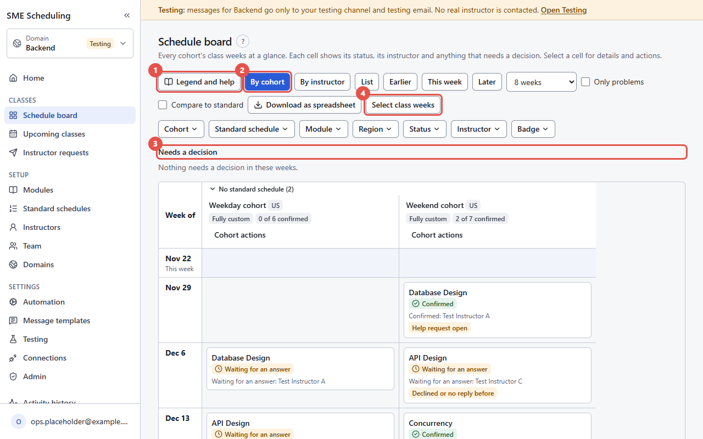
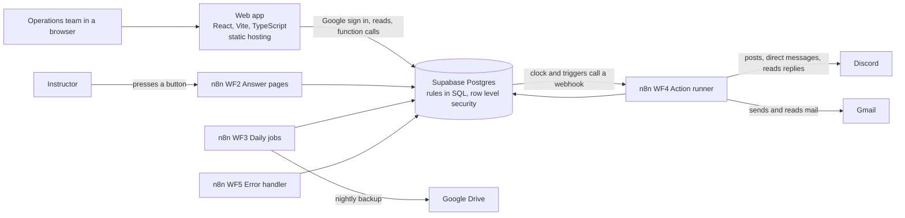

# SME Scheduling

SME Scheduling plans instructor led classes, asks instructors to teach them by Discord and email, and follows every
class week until it is taught. It is a web app for an operations team, with a Postgres database that holds every rule
and a set of n8n workflows that deliver the messages.



Contents: [Introduction](#introduction) · [Features](#features) · [Limitations](#limitations) ·
[Architecture](#architecture) · [Technology stack](#technology-stack) · [Installation](#installation) ·
[Configuration](#configuration) · [Running the project](#running-the-project) · [Development](#development) ·
[Testing](#testing) · [Deployment](#deployment) · [Troubleshooting](#troubleshooting) · [Security](#security) ·
[Performance](#performance) · [Future improvements](#future-improvements) · [FAQs](#faqs) ·
[Changelog](#changelog) · [License](#license)

## Introduction

### Overview

A **domain** (a program area such as Backend) has **modules**, **cohorts** and **class times**. The team plans a
**class week** (the classes of one module taught by one instructor) for a cohort, by hand or from a standard schedule.
About 30 days before the class the app asks the first instructor in the module's order, reminds them, moves to the
next one if needed, confirms the first Yes, reminds them before class and records everything.

### The problem

Finding instructors by hand means tracking spreadsheets, chasing replies, double bookings across programs, wrong time
zones around daylight saving changes, and nobody knowing what was already sent to whom.

### Why it exists

To make asking, confirming and reminding automatic and safe, while leaving every judgement call (a typed reply, a
proposed time, a clash) to a person.

### Objectives

- One instructor asked at a time; the first valid Yes confirms; no "someone else got it" messages.
- No instructor booked twice at the same moment, in any cohort, domain or time zone.
- No message sent twice.
- Every change, message and answer visible in an Activity history that nobody can edit.
- Run on free or already owned plans.

### What it solves, and for whom

| Who             | What they get                                                                                             |
| --------------- | --------------------------------------------------------------------------------------------------------- |
| Operations team | A Home page of tasks, a Schedule board of every cohort, and automatic asking and reminding                |
| Admins          | Control of who may sign in, who may receive messages, Discord servers, and one button to pause everything |
| Instructors     | A message with the class times in two time zones and buttons to answer. No account and no app to install  |
| Developers      | Business rules in one place (SQL), tested with database, unit and browser tests                           |

### Key benefits

- The screen can never save what the database would refuse, because the database enforces every rule.
- The automation can be paused, switched off or rolled back without losing data.
- It runs fully on one computer for development and testing, with no external accounts.

## Features

| Area                | What it does                                                                                                                                                                     |
| ------------------- | -------------------------------------------------------------------------------------------------------------------------------------------------------------------------------- |
| Home                | A Get started list for the chosen domain, tasks that need a person (urgent first), summary cards and this week's classes                                                         |
| Schedule board      | Views by cohort, by instructor and as a list; one status per cell with colour, icon and words; badges for problems; filters; comparison with the standard schedule; bulk actions |
| Upcoming classes    | Every class week with time zone, status and instructor; plan classes, add one class, download as a spreadsheet; a side panel with every action                                   |
| Instructor requests | Who is being asked; ask the next one, start asking now, change the order, ask a chosen person, assign and confirm, record a phone confirmation                                   |
| Domains             | Status (Draft, Testing, Live, Paused), Discord server and alert channel, teams, class types, holidays, cohorts, breaks and cohort merges                                         |
| Modules             | Class times, instructor order (Primary, Backup 1, Backup 2), owners and operations team, with versions per cohort                                                                |
| Standard schedules  | Named module sequences with break weeks; plan up to 20 cohorts at once; reset a cohort to the standard                                                                           |
| Instructors         | One record per person across domains: email, Discord username, a channel per domain, contact check, unavailable dates, monthly limit, test instructors                           |
| Team                | Team members, job titles, Discord usernames, removing and restoring access                                                                                                       |
| Settings            | Timing rules per domain or cohort, message texts with preview, testing and a practice clock, connection health and usage, admin controls                                         |
| Activity history    | Everything that happened and who did it, with filters, search, undo for safe edits and download                                                                                  |
| In app help         | 20 guides with pictures                                                                                                                                                          |

### How the main rules work

- **Asking in order.** One open request per class week. No answer: a reminder, then the next person. The closer the
  class, the shorter the wait. When nobody is left, the week shows **Needs instructor** with an urgent task.
- **Who is skipped.** People not in use, unavailable, busy at that time, who already declined that week, or (in a Live
  domain) whose contact details are unchecked, each with the reason shown.
- **Sooner class first.** Nobody holds two open requests for overlapping classes; the sooner class is asked first.
- **Time zones.** Each cohort is **US** (US Pacific) or **India**. Times are stored in UTC and converted with named time
  zones, so a 9:00 AM class stays at 9:00 AM after a clock change. Times that do not exist or happen twice are caught.
- **Checks.** Every save and preview returns **Block** (cannot be saved), **Warning** (saved with a written reason) or
  **Information**.
- **Changes.** Releases and replacements, time changes, times proposed by instructors, breaks, cohort holidays, shared
  classes, cohort merges, cancellations and restores, each with a preview.
- **Messages.** Written to the database before they are sent, with a unique key. A temporary failure is tried up to
  4 times in all (waiting about 1, 5 and 15 minutes). A message the automation took and never reported is not resent
  by itself: it shows **Check needed** and a person decides.
- **Safety nets.** Pause all messages, a beta rule that limits who can be contacted, a daily email limit, and a Draft
  status in which nothing is sent.

### Supported use cases

Cohort based programs with repeating weekly classes, several programs sharing instructors, classes taught in US Pacific
and India time, and an operations team that wants an audit trail.

## Limitations

- Time zones are limited to US Pacific and India.
- Messaging is Discord and email only. Instructors answer through links; they have no sign in.
- Every team member sees every instructor and every domain (there is no per team data separation).
- Outside Testing, a typed email reply is filed against the instructor's newest open request, which may not be the one
  they replied to.
- The Instructors page reads bookings and instructor orders without paging, so very long lists are cut at 1,000 rows.
- On a large Schedule board every cell is redrawn on each update, so keyboard focus can be lost and it can feel slow.
- Activity history search looks only at the rows already loaded.
- Bulk actions on class weeks run one at a time and stop at the first error.
- "Send reminder again" can be disabled, or point at an earlier instructor, after filters change or a replacement.
- Some archive and add instructor actions show an inaccurate message.
- Plan classes does not show an error when changing a week's module fails.
- Schedule board counts ignore filters, and a program break row can hide class weeks in that week.
- The refusal of outside accounts at sign up needs a hook switched on in the Supabase dashboard
  ([docs/DEPLOYMENT.md](docs/DEPLOYMENT.md)); the database also checks every request.

## Architecture



| Component     | Responsibility                                                                                                  | Folder      |
| ------------- | --------------------------------------------------------------------------------------------------------------- | ----------- |
| Database      | Every business rule, message text, permission check and the clock; 53 tables, row level security on all of them | `supabase/` |
| Web app       | Screens for the team. It reads tables and calls database functions; it holds no rules of its own                | `app/`      |
| Automation    | Delivers messages, serves answer pages, reads replies, backs up. No business rules                              | `n8n/`      |
| Scripts       | Local test stack, test data, checks, backup, clock and admin commands                                           | `scripts/`  |
| Browser tests | Playwright scenarios and page tests with accessibility checks                                                   | `e2e/`      |

**One message from start to finish:** the database clock finds a class week due for asking, writes a message row and
calls WF4. WF4 takes the waiting messages, sends them by Discord or Gmail and reports each result. The instructor
presses Yes; WF2 shows a confirmation page and records the answer in the database, which confirms the booking and
queues the confirmation.

Key design decisions: rules live in SQL so the app and the automation cannot disagree; the automation is replaceable;
messages are never duplicated; the app starts empty; nothing destructive happens without a preview. Details, diagrams
and the data model: [docs/ARCHITECTURE.md](docs/ARCHITECTURE.md).

## Technology stack

| Layer                | Used                                                                                                                                     |
| -------------------- | ---------------------------------------------------------------------------------------------------------------------------------------- |
| Languages            | TypeScript, SQL (PL/pgSQL), JavaScript in n8n code nodes, CSS                                                                            |
| Web app              | React 19, Vite 8, TypeScript 6, Tailwind CSS 4, TanStack Query and Table, React Router 7, Radix UI, dnd kit, Luxon, Sonner, Lucide icons |
| Database and sign in | Supabase: Postgres 17, Auth with Google, row level security, Realtime, `pg_cron`, `pg_net`, Vault                                        |
| Automation           | n8n (Cloud or self hosted)                                                                                                               |
| External services    | Discord API (bot), Gmail and Google Drive through n8n, Google sign in                                                                    |
| Hosting              | Vercel (`vercel.json`); any static host works                                                                                            |
| Tests and quality    | Vitest, pgTAP, Playwright, axe core, ESLint, Prettier, GitHub Actions                                                                    |

## Installation

Short version; the full walk through is [docs/SETUP.md](docs/SETUP.md).

**Requirements**

- Node.js 22.22.2 or later in the 22 line, 24.15 or later in the 24 line, or 26 and later, with npm
- Docker Desktop (the local database runs in containers)
- Git; on Windows also Git Bash, which comes with Git

```bash
git clone https://github.com/ANI-IN/sme-scheduling-platform.git
cd sme-scheduling-platform
npm ci
npm run db:start
```

On Windows, copy `.npmrc.windows-example` to `.npmrc` first so the npm scripts run in Git Bash.

Create `app/.env.local` from `app/.env.example`, fill in the publishable key that `npm run db:start` printed, set
`VITE_ALLOWED_EMAIL_DOMAIN=example.com` and `VITE_ENABLE_DEV_LOGIN=true`, then:

```bash
npm run dev
```

Open <http://localhost:5173>, enter any `@example.com` address, and open the sign in link from the local mail catcher
at <http://127.0.0.1:55424>. The app starts empty: follow **Get started** on Home.

## Configuration

Nothing secret is needed for local development or tests.

| File                   | Holds                                                     | In Git                               |
| ---------------------- | --------------------------------------------------------- | ------------------------------------ |
| `app/.env.local`       | The web app's settings (`VITE_*`, visible to the browser) | No; copy `app/.env.example`          |
| `.env.production`      | Settings for scripts that talk to a hosted database       | No; copy `.env.example`              |
| `n8n/instance.json`    | Your n8n, Discord, Gmail and Drive identifiers            | No; copy `n8n/instance.example.json` |
| `supabase/config.toml` | The local Supabase stack                                  | Yes                                  |

**Mandatory for a real deployment:** a Supabase project, Google sign in, an n8n instance, a Discord bot and a Gmail
mailbox. **Optional:** Google Drive backups; Vercel (any static host will do). Every variable and credential:
[docs/CONFIGURATION.md](docs/CONFIGURATION.md).

## Running the project

| Command                                                  | What it does                                                        | What you should see                           |
| -------------------------------------------------------- | ------------------------------------------------------------------- | --------------------------------------------- |
| `npm run db:start`, `npm run db:stop`                    | Starts or stops the local database                                  | Addresses and keys on start                   |
| `npm run db:reset`                                       | Rebuilds the local database from the migrations (erases local data) | `Finished supabase db reset`                  |
| `npm run dev`                                            | The web app on port 5173                                            | A local address to open                       |
| `npm run admins:local -w scripts -- add you@example.com` | Makes a signed in person an admin of the local database             | The admin list                                |
| `npm run check`                                          | Format, lint, types, unit tests, production build                   | Ends with `Production build is clean`         |
| `npm test`                                               | Unit tests of the app and the scripts                               | All tests passing                             |
| `npm run db:test`                                        | Every database test on throwaway databases (needs `db:start`)       | `All files passed.`                           |
| `npm run mock -- --race`                                 | A whole class timeline with no accounts, printing every message     | A timeline, then the race checks              |
| `npm run e2e`                                            | Every browser test in a separate temporary stack (about 3 hours)    | A pass count per phase                        |
| `npm run e2e -- --project=scenarios`                     | The scenario tests only                                             | A pass count                                  |
| `npm run build`                                          | The production app in `app/dist`                                    | Vite's file list                              |
| `npm run help:screenshots`                               | Remakes the help pictures                                           | One tick per picture                          |
| `npm run scan-text -w scripts`                           | Checks the wording rules                                            | A line starting `No dashes`                   |
| `npm run check-rollbacks -w scripts`                     | Proves each rollback file undoes its migration                      | `Every rollback undoes its migration exactly` |
| `npm run n8n-export -w scripts`                          | Builds the workflows for your n8n                                   | Files in `n8n/generated/`                     |

Commands for a hosted database (backup, clock, configuration, admins) are in
[docs/DEPLOYMENT.md](docs/DEPLOYMENT.md).

## Development

Layout, conventions, how to add a feature and how to debug: [docs/DEVELOPMENT.md](docs/DEVELOPMENT.md). The short
loop: write a failing database or unit test, add a new migration with its rollback file, change the app, run
`npm run check` and `npm run db:test`, then the browser tests for the area you touched.

## Testing

Database tests (pgTAP), unit tests (Vitest), browser tests (Playwright with accessibility, layout and console error
checks), a mock journey with race checks, a rehearsal of the message journey, and migration and rollback checks. See
[docs/TESTING.md](docs/TESTING.md) and the latest results in [docs/TEST_REPORT.md](docs/TEST_REPORT.md).

## Deployment

Database migrations to Supabase, workflows to n8n and the static app to your host, then live checks, with a verified
backup before every change and a written way back for each part: [docs/DEPLOYMENT.md](docs/DEPLOYMENT.md).

## Troubleshooting

Setup, dependency, sign in, messaging and automation problems with their causes and fixes:
[docs/TROUBLESHOOTING.md](docs/TROUBLESHOOTING.md). The three most common while setting up:

| Problem                                                    | Fix                                                          |
| ---------------------------------------------------------- | ------------------------------------------------------------ |
| An npm script fails on Windows with a path or syntax error | Copy `.npmrc.windows-example` to `.npmrc`                    |
| Database commands fail                                     | Start Docker Desktop, then `npm run db:start`                |
| "The app is not configured yet"                            | Create `app/.env.local` with the address and publishable key |

## Security

- On hosted setups: Google sign in only, limited to a company domain and optionally to a named list, checked by the
  database on every request.
- Row level security on every table; admin actions are checked in the database, not only hidden on screen.
- The app holds only the publishable key. The secret key lives only in n8n; the webhook key only in n8n and Supabase
  Vault.
- Answer links carry random tokens; opening one records nothing, only pressing the button does.
- Activity history is append only.
- No secret belongs in this repository: [docs/CONFIGURATION.md](docs/CONFIGURATION.md#secrets).

To report a security problem, open a private security advisory on the repository.

## Performance

`npm run e2e:scale` loads 60 cohorts, 160 instructors and 1,560 class weeks and requires each main page and the
Schedule board to show its data within 8 seconds. The database calls the automation only when there is work, and slows
reply checking as the monthly n8n run count grows (from 5,000, 6,500 and 8,000 runs).

Plan limits to watch: Supabase database size (500 MB on the free plan), the daily email limit (1,000 by default) and
your n8n plan's monthly runs. **Settings, Connections, Usage** shows them.

## Future improvements

- Limit what each team member sees to their own domains.
- File email replies against the message that was answered.
- Page long lists, search all of Activity history, and report bulk actions item by item.
- A fallback channel per instructor and a daily check of saved channels.
- More time zones.

## FAQs

**Does an instructor need an account?** No. They answer from the buttons in the message.

**What happens if two people say Yes?** Only one request is open per class week, and the database allows one booking.

**What if the automation is down?** Messages wait and are sent when it returns, once each.

**Can I try it without Discord or Gmail?** Yes: `npm run mock -- --race` and the browser tests need no accounts.

**Why do some names say "sandbox"?** `Sandbox` is a retired environment name that the database still accepts. New
setups use Development on a computer and Production when hosted.

**Why do code comments mention decision numbers?** They refer to the project's private decision log, which is not part
of this repository.

**Why are the names in the history odd?** Personal and company details in earlier commits were replaced with invented
ones before this repository was published.

## Changelog

[docs/CHANGELOG.md](docs/CHANGELOG.md).

## License

No license is granted. All rights are reserved; this is a private repository. The third party packages it uses keep
their own licenses.

This project was built with the help of AI coding assistants; commit messages in the earlier history record which.
