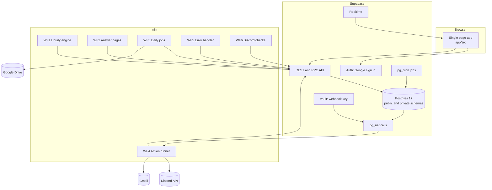
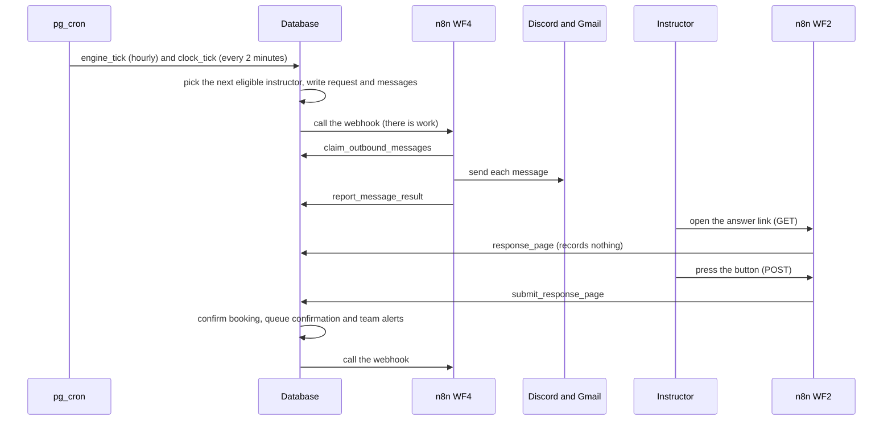
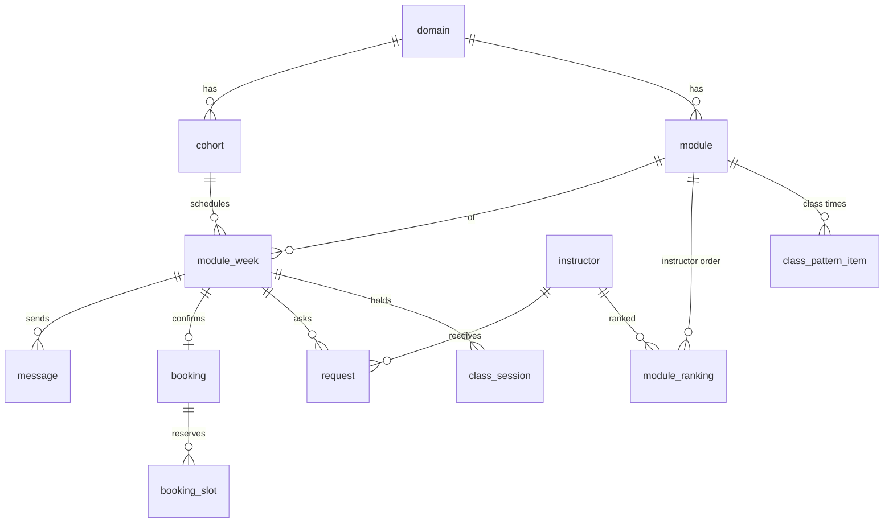

# Architecture

Three parts do the work. The **database** holds every rule. The **web app** shows the data and calls database
functions. The **automation** (n8n) moves messages in and out. Setup is in [SETUP.md](SETUP.md), settings in
[CONFIGURATION.md](CONFIGURATION.md).

## Components

## Responsibilities

| Component | Does | Does not |
|---|---|---|
| Database | Eligibility, asking order, confirming, clashes, holidays, breaks, message texts and routing, permissions, history, the clock | Talk to Discord or Gmail directly |
| Web app | Show, filter and edit; call functions; show previews and the database's own error messages | Decide any business rule |
| n8n | Take queued messages, send them, report results, serve answer pages, pass replies in, back up | Decide who is asked or what is said |
| Scripts | Test stack and data, checks, backups, clock, admins, configuration | Run in production on their own |

## Execution flow: asking for a class week

## Data flow

- **In:** the team's edits (RPC calls), instructors' answers (WF2), typed replies and bounces (WF4), Discord server,
  channel and member lookups (WF4).
- **Out:** rows in `message`, delivered by WF4; the nightly backup (WF3); live updates to open browsers (Realtime).
- Times are stored in UTC. A class keeps its region and is shown in its local zone.

## Database

Two schemas hold the project: `public` (tables and the functions the app and n8n call; row level security on every
table) and `private` (internal functions, not exposed by the API).

| Group | Tables |
|---|---|
| Programs | `domain`, `cohort`, `module`, `class_type`, `class_pattern_item`, `module_resource`, `holiday` |
| People | `team_member`, `domain_team`, `module_owner`, `module_operations`, `instructor`, `instructor_email`, `instructor_unavailability`, `beta_access` |
| Order | `module_ranking`, `manual_queue_item` |
| Schedule | `module_week`, `class_session`, `standard_schedule` (with `_module`, `_break`, `_class`), `cohort_break`, `program_break`, `cohort_holiday`, `cohort_merge`, `time_proposal` |
| Asking | `request`, `response_link`, `booking`, `booking_slot` |
| Work | `attention_item`, `reminder`, `help_request`, `checklist_item`, `action_queue` |
| Messages | `message`, `message_template` |
| Discord | `discord_server`, `discord_channel`, `discord_server_domain`, `instructor_channel`, `channel_check`, `discord_cursor` |
| System | `app_config`, `system_state`, `setting_definition`, `setting`, `history_event`, `app_error`, `clock_state`, `n8n_usage` |

- `booking_slot` has a database exclusion rule that makes two overlapping bookings of one instructor impossible.
- `message.unique_key` makes every message idempotent.
- `history_event` is append only.

### Database jobs

| Job | Schedule | Purpose |
|---|---|---|
| `sme-engine-hourly` | minute 30 of every hour | The automatic check for every domain |
| `sme-clock` | every 2 minutes | Calls WF4 only when there is work |
| `sme-run-log-purge` | 21:15 UTC daily | Keeps 7 days of the job log |

## Web app

`app/src/pages` holds one file per screen, `app/src/components` shared pieces, `app/src/lib` data access and pure logic
(tested with Vitest), and `app/src/help` the in app guides. Data is read with TanStack Query; Realtime changes refresh
the affected queries, with periodic polling as a fallback. Each page has its own error boundary.

| Route | Screen |
|---|---|
| `/` | Home |
| `/board` | Schedule board |
| `/classes` | Upcoming classes |
| `/requests` | Instructor requests |
| `/setup/domains`, `/setup/modules`, `/setup/standards`, `/setup/instructors`, `/setup/team` | Setup |
| `/settings/automation`, `/settings/messages`, `/settings/testing`, `/settings/connections`, `/settings/admin` | Settings |
| `/activity` | Activity history |
| `/help` | Help |

## Integrations

| Service | Used for | Where configured |
|---|---|---|
| Google sign in | Team sign in | Supabase Auth |
| Discord bot | Instructor and team messages, reading replies, finding channels and people | n8n credential; app screens |
| Gmail | Email out, replies and bounces in | n8n credential |
| Google Drive | Nightly backup | n8n credential (optional) |

The workflows are described in [../n8n/README.md](../n8n/README.md).

## Design decisions

1. **Rules in the database.** The app and the automation cannot disagree, and every path gets the same checks.
2. **Write, then send.** A message exists as a row before it is sent, with a unique key; results are reported back.
3. **Never guess.** An unreported send becomes "Check needed"; a typed reply becomes a task; a person decides.
4. **The database keeps the clock**, so the automation runs only when there is work.
5. **The app starts empty.** No sample data is built into a real setup.
6. **Reversible changes.** Migrations come with rollback files that are checked automatically.
