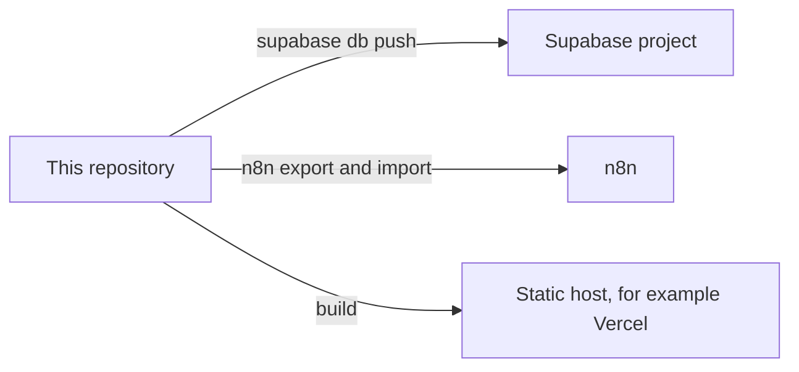

# Deployment

How to put the system online and change it safely. Values and secrets: [CONFIGURATION.md](CONFIGURATION.md).

## What runs where



## Requirements

- A Supabase project (the free plan works; note its limits below).
- A Google Cloud OAuth client for sign in (internal, for your company).
- n8n (Cloud or self hosted).
- A Discord application with a bot, and a Gmail mailbox for sending.
- A static host. Vercel's free Hobby plan is for non commercial use; use a paid plan or another host for company use.

## First deployment

### 1. Database

```bash
npm ci
npm run db:login
npm run db:link -- your-project-ref
npm run db:push -- --remote --dry-run
npm run db:push -- --remote
```

Without `--remote`, `db:push` goes to your local database.

In the Supabase dashboard: turn on the Google provider with your client ID and secret; turn the Email provider off but
keep new sign ups allowed (so first Google sign ins work); add the **Before User Created** hook
`public.hook_before_user_created`.

### 2. Settings in the database

Copy `.env.example` to `.env.production`, fill in `DATABASE_URL`, `SUPABASE_PROJECT_REF`, `ALLOWED_EMAIL_DOMAIN`,
`RESPONSE_BASE_URL` and `APP_BASE_URL`, then:

```bash
npm run configure:production -w scripts
```

The database refuses `Development` for a hosted address, and refuses any data reset in Production.

### 3. The first admin

Sign in to the app once, then:

```bash
npm run admins -w scripts -- add you@yourcompany.com
```

After that, admins manage each other and the beta list on **Settings, Admin**.

### 4. Automation

Follow [../n8n/README.md](../n8n/README.md): create the credentials, copy `n8n/instance.example.json` to
`n8n/instance.json`, export, import (the error workflow first), and publish. Then store the webhook key in Supabase
Vault and switch the database clock on:

```sql
select vault.create_secret('paste the key here', 'n8n_poke_key');
```

```bash
npm run clock -w scripts -- on https://your-n8n/webhook/sme-poke
```

Use your webhook path, including any `pathPrefix`. `npm run clock -w scripts -- status` shows whether it works.

### 5. Web app

`vercel.json` holds the build settings (install `npm ci`, build `npm run build -w app`, output `app/dist`, every
address opens the app). Set the `VITE_*` variables in the host and never set `VITE_ENABLE_DEV_LOGIN` there.

```bash
npx vercel@65.14.0 deploy --prod
```

Other static hosts work too; `app/public/_redirects` handles Cloudflare Pages. Then add the app address to Supabase's
URL configuration and to the Google client's allowed origins.

### 6. In the app

1. **Settings, Connections**: open the invite link, add the bot to your Discord server, press **Refresh servers** and
   approve it for your domains. Choose the admin alert channel and the sender email.
2. Follow **Get started** on Home: domain, server, team, instructors, modules, cohort, classes.
3. Put the domain in **Testing**, run a practice class on **Settings, Testing**, watch it for a while, then set it
   **Live**.

## Changing a running system

For every change, in this order:

1. Test everything locally ([TESTING.md](TESTING.md)).
2. Pause all messages if the change touches sending or the engine.
3. Back up and verify (Docker running):

   ```bash
   npm run backup -w scripts -- --label before-my-change
   ```

   It dumps the hosted database to your backup folder, restores it into a local throwaway database and compares every
   table's row count. It refuses any database other than `SUPABASE_PROJECT_REF`.
4. Database: dry run, check it lists only the new migrations, then push.
5. Automation: export, update only the changed workflows, publish, note their previous versions.
6. App: deploy; note the previous deployment.
7. Live checks, then turn messages back on.

## Live checks

- Sign in works, an account outside the list is refused, Home loads with no console errors.
- **Settings, Connections** shows Working or Ready for each connection.
- A domain in Testing delivers a message to the testing channel and email, and the answer page records a press.
- `npm run clock -w scripts -- status` shows recent calls; n8n executions succeed.

## Rolling back

Roll back first, then fix locally. Undo in the reverse order of deploying unless the change says otherwise.

| Part | How |
|---|---|
| App | Your host's previous deployment (`npx vercel@65.14.0 rollback`) |
| Automation | Restore each changed workflow's previous version in n8n and publish it |
| Database | Pause messages; run the migration's file in `supabase/rollback/`; delete its row in `supabase_migrations.schema_migrations` |
| Last resort | Restore the backup (everything since is lost) |
| Clock | `npm run clock -w scripts -- off`, then switch on the schedule triggers of WF1 and WF4 in n8n |

## Production considerations

- **Free plan limits:** Supabase 500 MB database, projects pause after a week without use (the clock prevents this);
  Gmail daily sending limits and the app's own daily email limit; n8n monthly runs (shared with other workflows in the
  account); Discord rate limits.
- **Usage:** Settings, Connections, Usage (admins).
- **Backups:** the nightly Google Drive export (WF3) and the verified backup before each change. Neither contains the
  webhook key in Vault; keep it in your password manager.
- **Keep secrets out of Git and chat.** Rotate the webhook key if it was ever visible, and update both the n8n
  credential and Vault together.
