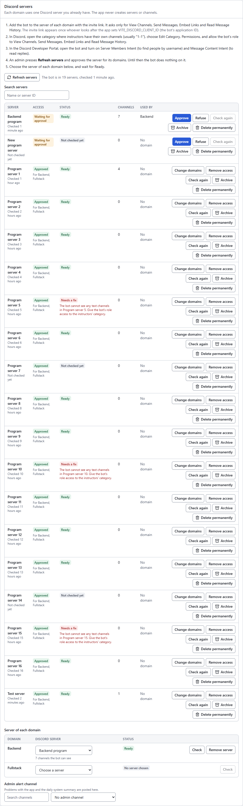
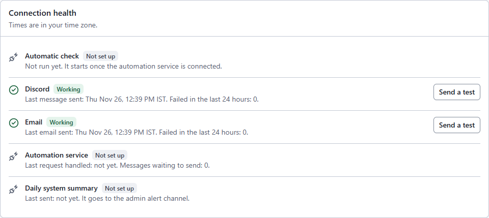

# Setup guide

This guide connects the app to the real services, for two separate environments:

- **Sandbox**: a full copy of the system for practice and testing. It has its own database, its own Discord bot and
  server, its own mailbox and its own web address. It can only send messages to the test Discord server and to the
  email domains you allow. It can never message a real instructor.
- **Production**: the real system the Operations team uses every day. It never messages an instructor marked as a
  test instructor.

You do not need to write code. Follow the parts in order and tick the checklist at the end as you go.
Set up **Sandbox first**, try it, then repeat the same steps for Production.

**Much of the Sandbox is already set up.** docs/CONFIGURATION.md lists every value, marks what is done, and gives
the commands still to run, in order. This guide explains each part; where a Sandbox value is known, it is shown.

**Keep secrets safe.** Secret keys, tokens and passwords go only into the place this guide names (Supabase, n8n,
Vercel or a local `.env.sandbox` or `.env.production` file on your computer). Never paste them into chat, tickets,
documents, the checklist or the repository. Keep a copy in your company password manager.

**What you need before you start**

- A Google Workspace account in the company domain (`yourcompany.com`).
- Admin rights on the Discord servers the bot will be in (15 or more is fine), and the Sandbox test server.
- n8n Cloud (`https://your-instance.app.n8n.cloud`) where you can create credentials and import workflows.
- A Vercel account on a paid plan, or a free Cloudflare account (see part 7).
- Node.js 22 and Git installed on your computer, and a copy of this repository. On Windows, copy
  `.npmrc.windows-example` to `.npmrc` in the repository folder before you start, so the commands below run in Git Bash.
- About half a day for Sandbox, and about two hours for Production.

---

## Part 1. Supabase (the database)

Do this once for Sandbox and once for Production. Each environment has its **own** Supabase project.

### 1.1 Create the project

**Sandbox: done.** Project ID `abcdefghijklmnopqrst`, region South Asia (Mumbai), organization "NP Automation".

For Production: go to <https://supabase.com/dashboard>, **New project**, name it `sme-scheduling-production`, choose a
strong database password and save it in the password manager, pick the same region, and wait about two minutes.

### 1.2 Collect the project values

1. **Project URL** and **Project ref**: **Project Settings → Data API**. The URL looks like
   `https://abcdefghijklmnop.supabase.co`; the ref is the part before `.supabase.co`.
2. **Publishable key** (`sb_publishable_…`): **Project Settings → API Keys**. It is safe to use in the web app.
3. **Secret key** (`sb_secret_…`): **Project Settings → API Keys → Secret keys → New secret key**, name it `n8n`.
   This key can read and change everything. It goes only into n8n.
4. **Database connection string**: click **Connect** at the top of the dashboard → **Session pooler** → copy the URI
   and put your database password in place of `[YOUR-PASSWORD]`. It is used only on your computer in step 1.4.

### 1.3 Create the tables, rules and functions

In a terminal in the repository folder:

```bash
npm ci
```

```bash
npm run db:login
```

```bash
npm run db:link -- <the project ref>
```

```bash
npm run db:push
```

`db:push` applies every file in `supabase/migrations/` in order. Run it again after each app update.

**The app starts empty** (decision 251). There is no starting data to load in either environment: you add every
domain, module, instructor and team member in the app, guided by the Get started list on Home.

### 1.4 Tell the database which environment it is

1. Copy `.env.sandbox.example` (in the repository root) to `.env.sandbox`; it already holds every Sandbox value except
   the database connection string. For Production, copy `.env.example` to `.env.production`. Both files are ignored
   by Git, so they never leave your computer.
2. Fill in:

   | Name | Sandbox | Production |
   |---|---|---|
   | `DATABASE_URL` | Sandbox connection string from 1.2 | Production connection string from 1.2 |
   | `APP_ENVIRONMENT` | `Sandbox` (set by `configure:sandbox`) | `Production` (set by `configure:production`) |
   | `ALLOWED_EMAIL_DOMAIN` | `yourcompany.com` | The same |
   | `SANDBOX_ALLOWED_DISCORD_SERVERS` | `1200000000000000010` | Leave empty |
   | `SANDBOX_ALLOWED_EMAIL_DOMAINS` | `yourcompany.com` | Leave empty |
   | `RESPONSE_BASE_URL` | `https://your-instance.app.n8n.cloud/webhook/sandbox-respond` | `https://your-instance.app.n8n.cloud/webhook/respond` |
   | `APP_BASE_URL` | `http://localhost:5173` until it is hosted, then the hosted address | The Production app address |

3. Run:

   ```bash
   npm run configure:sandbox -w scripts
   ```

   or, for Production:

   ```bash
   npm run configure:production -w scripts
   ```

   It prints the environment and the allowed sign in domain. Run it again whenever you change one of these values
   (for example after you know the Discord server ID, the WF2 webhook or the app address).

   Until this has run, the database counts as Sandbox: only company Google accounts can sign in and nothing can be
   reset. `Development` is refused for a database that is not on your own computer. The answer link
   (`RESPONSE_BASE_URL`) and the app address (`APP_BASE_URL`) can only be set here, never from inside the app, so
   nobody can send instructors' answer buttons to another address.

### 1.5 Only company Google accounts may sign in

1. **Authentication → Sign In / Providers**: switch **off** "Allow new users to sign up" for **Email**, and keep
   **Google** on (you fill it in at 2.2).
2. **Authentication → Hooks → Add hook → Before User Created** → type **Postgres** → schema `public`, function
   `hook_before_user_created` → **Create hook**.

   This hook refuses every account outside your company domain and records the attempt in Activity history.
   In Production it also refuses anything that is not a company Google Workspace account. The database checks the same
   rule on every request, so data stays private even if the hook is switched off by mistake.

### 1.6 Web addresses

**Authentication → URL Configuration**:

- **Site URL**: the app address for this environment (from part 7). You can come back to this after part 7.
- **Redirect URLs**: add the same address followed by `/**`, for example `https://scheduling.yourcompany.com/**`.

---

## Part 2. Google sign in

**Sandbox: done.** The Google Auth Platform app is **Internal** (company accounts only), its client ID is
`000000000000-yourclientid.apps.googleusercontent.com`, and its secret is saved in Supabase
**Authentication, Sign In / Providers, Google**.

For Production: in <https://console.cloud.google.com>, **Google Auth Platform, Clients, Create client**, type **Web
application**, with the **Callback URL** from the Production Supabase project (`https://<project ref>.supabase.co/auth/v1/callback`)
as the Authorized redirect URI. Paste its Client ID and secret into the Production Supabase project, Google provider.

**No other Google Cloud setup is needed** (decision 264): n8n Cloud signs in to Gmail and Google Drive itself, with
its own "Sign in with Google". There is no Gmail client ID, client secret, refresh token or service account.

---

## Part 3. The mailbox

Sandbox sends from, and reads replies to, `scheduling-mailbox@yourcompany.com`, through the n8n
credential `Gmail Sandbox` (done). The test instructors use plus addresses of the same mailbox, so every test email
arrives in the B2C inbox: `scheduling-mailbox+instructor-a@yourcompany.com`, `+instructor-b` and
`+instructor-c`. Production needs its own mailbox and an n8n credential `Gmail Production`.

---

## Part 4. Discord

The app uses Discord servers you already have. It never creates servers or channels.

### 4.1 Servers

- **Production**: each domain uses its existing Discord server (several domains may share one). The bot can be in
  15 or more servers: Settings, Connections lists them all with a status for each, checked a few at a time.
- **Sandbox: done.** Server `1200000000000000010`, with `#alerts` (`1200000000000000012`), `#admin-alerts`
  (`1200000000000000013`) and a category "Test instructors" with `#test-instructor-a`, `#test-instructor-b` and
  `#test-instructor-c`. **One more channel is needed: create `#testing`**. While a domain's status is Testing, all its
  messages go there. You choose it from the list in the app; no ID is needed.

### 4.2 One bot per environment

1. Go to <https://discord.com/developers/applications>, **New Application**, name `SME Scheduling Sandbox` (or
   `SME Scheduling`).
2. **Bot**, **Reset Token**, copy the token (it is shown once). It goes only into the n8n credential
   `Discord Bot Sandbox` or `Discord Bot Production` (type Discord Bot API). Never put it in a file that is committed.
   **Sandbox: done.**
3. On the same page, under **Privileged Gateway Intents**, switch on **Server Members Intent** (the app finds people
   by their Discord username) and **Message Content Intent** (the app reads typed replies). Save.
4. **General Information**: copy the **Application ID** (Sandbox: `1200000000000000017`). It goes into
   `VITE_DISCORD_CLIENT_ID` (part 7; it is not a secret). The app then shows the invite link on **Settings,
   Connections, Discord servers**.

You add the bot to the servers and choose channels in part 7.5, once the app is online and WF6 runs in n8n.

| Value | Where it comes from | Where it goes |
|---|---|---|
| Bot token (secret) | Developer Portal, Bot | n8n credential `Discord Bot Sandbox` (done) |
| Application ID | Developer Portal, General Information | `VITE_DISCORD_CLIENT_ID` (web app) |
| Sandbox server ID | Right click the server, Copy Server ID (turn on Developer Mode first) | `SANDBOX_ALLOWED_DISCORD_SERVERS` (1.4) |

---

## Part 5. n8n (the automation)

n8n only moves messages in and out. Every decision is made by the database.

1. In the repository run:

   ```bash
   npm run n8n-export -w scripts
   ```

   This writes `n8n/sandbox/` and `n8n/production/`. Each set has its own workflow names (`[Sandbox] …`,
   `[Production] …`), tag, credential names and webhook addresses, so both can live in the same n8n.
2. Follow `n8n/README.md` from section 2. In short, for each environment:
   1. The workflows use exactly these credential names. Sandbox already has the first three:
      `Gmail Sandbox`, `Discord Bot Sandbox`, `Google Drive Backups`. Create the other two: `Supabase Sandbox`
      (Header Auth, name `apikey`, value the secret key) and `Poke Secret Sandbox` (Header Auth, name `x-poke-key`,
      value a long random string from your password manager).
   2. Import the six files from `n8n/sandbox/` (or `n8n/production/`), WF5 first.
   3. In the **Config** node of WF1 to WF5 set `pokeKey`. The Sandbox Supabase address, the WF4 address and the backup
      folder (`your-drive-folder-id`, newest 30 backups kept) are already filled in.
   4. Set WF5 as the **Error workflow** of WF1 to WF4 and WF6. Publish WF5 and WF4 first, then the rest.
3. Copy the two webhook addresses:

   | Webhook | Sandbox | Production | Where it goes |
   |---|---|---|---|
   | WF2 confirm pages | `https://your-instance.app.n8n.cloud/webhook/sandbox-respond` | `…/webhook/respond` | `RESPONSE_BASE_URL` (already in `.env.sandbox.example`) |
   | WF4 poke | `https://your-instance.app.n8n.cloud/webhook/sandbox-sme-poke` | `…/webhook/sme-poke` | `VITE_N8N_POKE_URL` (already in `app/.env.sandbox.example`) |

---

## Part 6. OpenAI (optional)

The system works fully without AI. If you want a one line summary of typed replies for the Operations team:

1. Go to <https://platform.openai.com> → **API keys** → **Create new secret key**, name `SME Scheduling (<env>)`.
2. **Settings → Limits**: set a low monthly budget (for example 5 US dollars). Replies are short, so the real cost is
   under one dollar a month.
3. In n8n create a credential of type **OpenAI**, name `OpenAI Sandbox` or `OpenAI Production`, paste the key.
4. In WF1, add an **OpenAI** node where the note "Optional AI summary" says, using the smallest suitable model. It only
   fills the summary; it never decides anything.

You can skip OpenAI for Sandbox.

---

## Part 7. The web app (Vercel or Cloudflare Pages)

The app is a set of static files. Both options below work; choose one.

### 7.0 First, on your own computer

You can test the whole Sandbox before hosting anything: copy `app/.env.sandbox.example` to `app/.env.sandbox`, add
the publishable key and the poke key, and run `npm run dev:sandbox`. Open <http://localhost:5173> (the Supabase Site
URL and Redirect URLs already allow it) and sign in with your company Google account.

**Vercel** needs a paid plan (Pro) for company use: the free Hobby plan does not allow commercial use.
**Cloudflare Pages** is free for company use.

### 7.1 Put the code on GitHub

Push this repository to a **private** GitHub repository. Create a branch named `sandbox`: the Sandbox site is built from
it and the Production site from `main`.

### 7.2 Option A: Vercel

1. <https://vercel.com/new> → import the repository. Vercel reads `vercel.json`, so leave the build settings as they are
   (install `npm ci`, build `npm run build -w app`, output `app/dist`, and every address opens the app).
2. **Settings → Environment Variables**. Add each variable twice: once for **Production** with the Production values,
   once for **Preview** with the Sandbox values.

   | Name | Sandbox (Preview) | Production |
   |---|---|---|
   | `VITE_SUPABASE_URL` | Sandbox project URL | Production project URL |
   | `VITE_SUPABASE_PUBLISHABLE_KEY` | Sandbox publishable key | Production publishable key |
   | `VITE_ALLOWED_EMAIL_DOMAIN` | Your company domain | Your company domain |
   | `VITE_N8N_POKE_URL` | Sandbox WF4 address | Production WF4 address |
   | `VITE_N8N_POKE_KEY` | Sandbox poke secret | Production poke secret |
   | `VITE_DISCORD_CLIENT_ID` | Sandbox bot Application ID (4.2) | Production bot Application ID (4.2) |

   Never set `VITE_ENABLE_DEV_LOGIN` here; it is for your own computer only.
3. **Settings → Git → Production Branch**: `main`.
4. **Settings → Domains**: add your Production address (for example `scheduling.yourcompany.com`) for `main`, and a
   Sandbox address (for example `scheduling-sandbox.yourcompany.com`) for the branch `sandbox`.
5. Deploy. Changes to `main` update Production; changes to `sandbox` update Sandbox.

### 7.3 Option B: Cloudflare Pages

1. <https://dash.cloudflare.com> → **Workers & Pages → Create → Pages → Connect to Git** → choose the repository.
2. Build settings: framework **None**, build command `npm ci && npm run build -w app`, output directory `app/dist`.
3. **Settings → Variables and Secrets**: add `NODE_VERSION` = `22` and the variables from the table in 7.2, once for
   **Production** and once for **Preview**.
4. Production branch `main`. The `sandbox` branch is published at `https://sandbox.<project>.pages.dev`; you can add a
   custom domain for it.
   (`app/public/_redirects` makes every address open the app.)

### 7.4 Finish the links

1. Back in Supabase (1.6), set the **Site URL** and **Redirect URLs** to this environment's app address.
2. Put this environment's app address in `APP_BASE_URL` and the WF2 webhook in `RESPONSE_BASE_URL` (1.4) and run
   configure again.
3. Sign in to the app. Go to **Settings → Connections → Advanced: links** and fill in **Sender email**; the two links
   show there to check. Then connect Discord as in 7.5, including the **Admin alert channel**.

### 7.5 Connect Discord in the app

Do this once the app is online (7.2 or 7.3) and the workflows are published in n8n (part 5): WF6 answers
**Refresh servers** and **Check**.

1. Sign in to the app. **Settings, Connections, Discord servers**: press **Open the invite link** and add the bot to
   each server (the Sandbox bot to the Sandbox server only). The link asks for exactly four permissions: View
   Channels, Send Messages, Embed Links and Read Message History.
2. In each server, open the category of the instructors' channels (Sandbox: "Test instructors", often `1-1`), **Edit Category**, **Permissions**, add the bot's role and allow the same
   four permissions. Do the same for the alert, admin and testing channels if they are private.
3. Back on **Settings, Connections, Discord servers**, press **Refresh servers**. The servers the bot is in appear within a
   minute.
4. Choose the server of each domain. The app checks it and lists the channels the bot can see. Wait for **Ready**;
   if it says **Needs a fix**, it says exactly what to change.

   

5. **Setup, Instructors**: for each instructor, type their **Discord username** (for example `maya.k`, without @)
   and choose their channel for each domain from the list. The app finds their Discord account by itself and shows
   **Discord found**, or what is wrong. Nobody types Discord user IDs.

   

6. **Setup, Team**: a Discord username is optional. People without one get email instead.
7. **Setup, Domains** and **Settings, Testing**: choose the alert channel and the testing channel from the list.


---

## Part 8. First checks

### 8.1 Sandbox

1. Open the Sandbox address. A **Sandbox** label shows at the top of every page.
2. **Sign in with Google** with your company account. Try an account from outside the company: it must be refused.
3. **Home** shows the **Get started** list: add a domain, choose its Discord server, add team members, add
   instructors, add modules, create a cohort, plan classes. Each step opens the page where you do it. The app starts
   empty; **Settings, Testing, Reset Sandbox data** empties it again at any time.
4. **Setup, Instructors**: add the three test instructors with their plus addresses, tick **Test instructor**,
   choose their channels (`#test-instructor-a` and so on), then press **Send contact check** for one of them. It must
   arrive within a minute.
5. **Settings, Testing, Run a practice class** (while the domain's status is Testing). Every stage should pass.

   

6. **Settings → Connections**: Discord, Email and Automation service should all show **Working**.

   

7. Walk through the scenarios in the PRD (section 20.3) with the test instructors and the practice clock.
8. Run the manual checks with the real services in docs/TEST_REPORT.md (part "Checks only the real services can do").

### 8.1.1 The Sandbox journey, by hand

The automated journey on the hosted Sandbox is switched off (decision 252): it wrote to the Sandbox and needed direct
Gmail access. docs/READY_FOR_TESTING.md has the same journey as a short list of manual checks with real Discord and
email.

### 8.2 Production

1. Sign in. No label shows at the top. **Settings → Connections** shows **Working** for everything.
2. Follow the **Get started** list on Home: add the domains, team, instructors (with Discord usernames and a
   channel per domain, then **Send contact check** for each), modules, cohorts and classes.
5. Keep the domain in **Test** until the Operations team has watched a full week, then use **Settings → Testing → Go
   live**.

---

## Checklist

Tick each line when it is done. **Do not write secret values in this table**: for secrets write "in password manager".

| # | Item | Where to get it | Where to put it | Sandbox value | Production value | Done |
|---|---|---|---|---|---|---|
| 1 | Supabase project | supabase.com → New project | | | | ☐ |
| 2 | Supabase project URL | Project Settings → Data API | Vercel `VITE_SUPABASE_URL`; n8n Config `supabaseUrl` | | | ☐ |
| 3 | Supabase publishable key | Project Settings → API Keys | Vercel `VITE_SUPABASE_PUBLISHABLE_KEY` | | | ☐ |
| 4 | Supabase secret key (secret) | Project Settings → API Keys → Secret keys | n8n `Supabase Sandbox` (Header Auth `apikey`) | in password manager | in password manager | ☐ |
| 5 | Database password and connection string (secret) | Connect → Session pooler | `.env.sandbox` or `.env.production` `DATABASE_URL` | in password manager | in password manager | ☐ |
| 6 | Tables and functions | `npm run db:push` | Supabase | | | ☐ |
| 7 | Starting data | None: the app starts empty; follow Get started on Home | App | | | ☐ |
| 8 | Environment and sign in domain | You decide | `npm run configure:<env> -w scripts` | Sandbox | Production | ☐ |
| 9 | Sandbox allowed Discord servers and email domains | Discord server ID; your domain | `.env.sandbox`, then configure | | not used | ☐ |
| 10 | Sign in hook | Authentication → Hooks | Before User Created → `public.hook_before_user_created` | | | ☐ |
| 11 | Email sign up switched off | Authentication → Sign In / Providers | Supabase | | | ☐ |
| 12 | Google Cloud project, Internal | console.cloud.google.com | | | | ☐ |
| 13 | Google sign in client ID and secret (secret) | Google Auth Platform → Clients | Supabase → Providers → Google | in password manager | in password manager | ☐ |
| 14 | Gmail credential | n8n, Gmail OAuth2 API, Sign in with Google | n8n `Gmail Sandbox` | done | | ☐ |
| 15 | Google Drive credential | n8n, Google Drive OAuth2 API, Sign in with Google | n8n `Google Drive Backups` | done | | ☐ |
| 16 | Backup folder ID | Google Drive address bar | n8n WF3 (filled in) | `your-drive-folder-id` | | ☐ |
| 17 | Scheduling mailbox | The B2C mailbox | n8n Gmail sign in; app Sender email | `scheduling-mailbox@yourcompany.com` | | ☐ |
| 18 | Discord server | Discord | | | | ☐ |
| 19 | Sandbox Discord server ID | Right click server → Copy Server ID | Sandbox allow list (1.4); the app lists servers itself | | | ☐ |
| 20 | Discord bot token (secret) | Developer Portal → Bot | n8n `Discord Bot Sandbox` | done | in password manager | ☐ |
| 21 | Server Members Intent and Message Content Intent on | Developer Portal → Bot | | | | ☐ |
| 22 | Bot invited and can see channels | Invite link on Connections (7.5) | Discord server | | | ☐ |
| 23 | Admin, alert and testing channels | Chosen from the lists in the app (7.5) | App Connections, Domains, Testing | | | ☐ |
| 24 | Poke key (low sensitivity: it is visible in the app's files) | Password manager generator | n8n `Poke Secret Sandbox`, Config `pokeKey`, `VITE_N8N_POKE_KEY` | in password manager | in password manager | ☐ |
| 25 | Workflows imported and published | `n8n/sandbox/`, `n8n/production/` | n8n | | | ☐ |
| 26 | WF2 confirm page address | n8n WF2 webhook | `RESPONSE_BASE_URL` (1.4) | | | ☐ |
| 27 | WF4 poke address | n8n WF4 webhook | Vercel `VITE_N8N_POKE_URL`; n8n Config `pokeUrl` | | | ☐ |
| 28 | Error workflow set | n8n workflow Settings | WF1 to WF4 and WF6 | | | ☐ |
| 29 | OpenAI key (optional, secret) | platform.openai.com → API keys | n8n `OpenAI Sandbox` | skip | in password manager | ☐ |
| 30 | Hosting project | Vercel Pro or Cloudflare Pages | | | | ☐ |
| 31 | Hosting variables, including `VITE_DISCORD_CLIENT_ID` | Table in 7.2 | Vercel or Cloudflare | | | ☐ |
| 32 | App address | Vercel or Cloudflare Domains | Supabase URL Configuration; `APP_BASE_URL` (1.4) | | | ☐ |
| 33 | First checks | Part 8 | | | | ☐ |

---

## Your own computer (optional)

You need Docker Desktop and Node.js 22.

```bash
npm ci
```

```bash
npm run db:start
```

Copy `app/.env.example` to `app/.env.local` and use the local address and key that `db:start` prints (local ports are
5542x), `VITE_ALLOWED_EMAIL_DOMAIN=example.com` and `VITE_ENABLE_DEV_LOGIN=true`. Then:

```bash
node node_modules/vite/bin/vite.js app --config app/vite.config.ts --port 5173
```

Sign in with any `@example.com` address; the sign in link arrives in the local mail catcher at
<http://127.0.0.1:55424>.

Useful commands: `npm run db:test` (database tests), `npm test` (app tests), `npm run mock -- --race` (a full class
timeline without any accounts), `npm run check` (format, lint, types, tests and build).

**Windows and folder names with `&`:** npm's default Windows shell breaks on paths that contain `&`. If your folder
name has one, copy `.npmrc.windows-example` to `.npmrc` (it makes npm scripts run in Git Bash). `.npmrc` is not
committed.
