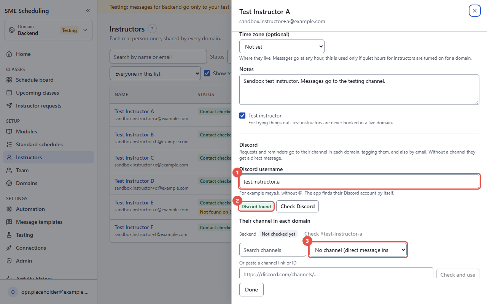
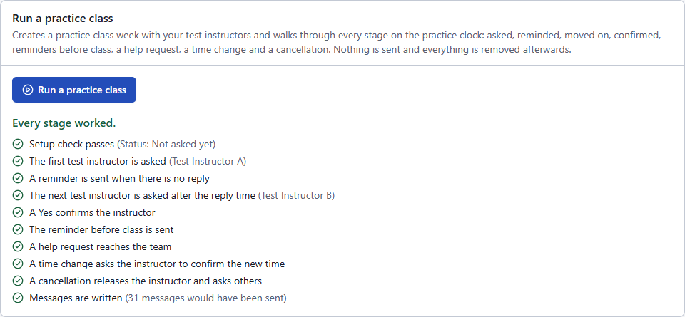

# Setup guide

This guide connects the app to the real services.

**There is one environment: Production.** It is the old Sandbox under a new name: the same Supabase project
`abcdefghijklmnopqrst`, the same n8n instance and the same Vercel app <https://your-app.vercel.app>. It was
switched on 22 November 2026 with `npm run configure:production -w scripts`, and the database now refuses any reset.
There is no Sandbox any more, and nothing in this guide asks you to set one up.

**Internal names keep the word Sandbox on purpose**, because renaming them could break things. They are internal names
only, not a second environment: the n8n credentials `Gmail Sandbox`, `Discord Bot Sandbox`, `Supabase Sandbox`,
`Poke Secret Sandbox` and `Google Drive Backups`, the n8n tag `Sandbox`, the webhook paths such as
`/webhook/sandbox-respond` and `/webhook/sandbox-sme-poke`, the folder `n8n/sandbox/`, the files `app/.env.sandbox`,
`.env.sandbox.example` and `app/.env.sandbox.example`, and the command `npm run dev:sandbox`. The live settings file
on your computer is `.env.production`.

You do not need to write code. Follow the parts in order and tick the checklist at the end as you go.

**Production is already set up.** docs/CONFIGURATION.md lists every value, marks what is done, and gives the commands,
in order. This guide explains each part; where a Production value is known, it is shown. The steps marked "for a new
setup" are only for building a second environment from scratch, which is not planned.

**Keep secrets safe.** Secret keys, tokens and passwords go only into the place this guide names (Supabase, n8n,
Vercel or a local `.env.production` file on your computer). Never paste them into chat, tickets,
documents, the checklist or the repository. Keep a copy in your company password manager.

**What you need before you start**

- A Google Workspace account in the company domain (`yourcompany.com`).
- Admin rights on the Discord servers the bot will be in (15 or more is fine), and the test Discord server.
- n8n Cloud (`https://your-instance.app.n8n.cloud`) where you can create credentials and import workflows. It is the
  owner's paid n8n Cloud Pro plan: 10,000 executions a month, shared with the other workflows in the same n8n account.
- A Vercel account on a paid plan, or a free Cloudflare account (see part 7).
- Node.js 22 and Git installed on your computer, and a copy of this repository. On Windows, copy
  `.npmrc.windows-example` to `.npmrc` in the repository folder before you start, so the commands below run in Git Bash.
- About half a day for a new setup.

---

## Part 1. Supabase (the database)

Production uses the Supabase project `abcdefghijklmnopqrst`. A new setup would need its **own** Supabase project.

### 1.1 Create the project

**Production: done.** Project ID `abcdefghijklmnopqrst`, region Northeast Asia (Tokyo, AWS `ap-northeast-1`), organization "NP Automation".

For a new setup: go to <https://supabase.com/dashboard>, **New project**, name it `sme-scheduling-production`, choose a
strong database password and save it in the password manager, pick the same region, and wait about two minutes.

### 1.2 Collect the project values

1. **Project URL** and **Project ref**: **Project Settings → Data API**. The URL looks like
   `https://abcdefghijklmnop.supabase.co`; the ref is the part before `.supabase.co`.
2. **Publishable key** (`sb_publishable_…`): **Project Settings → API Keys**. It is safe to use in the web app.
3. **Secret key** (`sb_secret_…`): **Project Settings → API Keys → Secret keys → New secret key**, name it `n8n`.
   This key can read and change everything. It goes only into n8n.
4. **Database connection string**: click **Connect** at the top of the dashboard → **Session pooler** → copy the URI
   and put your database password in place of `[YOUR-PASSWORD]`. It is used only on your computer in step 1.4.

### 1.3 Create the tables, rules and functions

In a terminal in the repository folder:

```bash
npm ci
```

```bash
npm run db:login
```

```bash
npm run db:link -- <the project ref>
```

```bash
npm run db:push
```

`db:push` applies every file in `supabase/migrations/` in order. Run it again after each app update.

**The app starts empty** (decision 251). There is no starting data to load, and each tester sets up their own domain:
you add every domain, module, instructor and team member in the app, guided by the Get started list on Home.

### 1.4 Tell the database which environment it is

1. The scripts read `.env.production` in the repository root. It replaced the old `.env.sandbox` (deleted on
   22 November 2026) and uses the same setting names. If you have none, copy `.env.sandbox.example` (the example keeps
   its old name) to `.env.production`. It holds the Production values except two: add the database connection string,
   and change `APP_BASE_URL` from `http://localhost:5173` to `https://your-app.vercel.app`. For a new setup, copy
   `.env.example` to `.env.production`. The file is ignored by Git, so it never leaves your computer.
2. Fill in:

   | Name | Production | A new setup |
   |---|---|---|
   | `DATABASE_URL` | The connection string from 1.2 | The new project's connection string from 1.2 |
   | `APP_ENVIRONMENT` | `Production` (set by `configure:production`) | The same |
   | `ALLOWED_EMAIL_DOMAIN` | `yourcompany.com` | The same |
   | `SANDBOX_ALLOWED_DISCORD_SERVERS` | `1200000000000000010` (not used in Production) | Leave empty |
   | `SANDBOX_ALLOWED_EMAIL_DOMAINS` | `yourcompany.com` (not used in Production) | Leave empty |
   | `RESPONSE_BASE_URL` | `https://your-instance.app.n8n.cloud/webhook/sandbox-respond` (the path keeps its name) | `https://<your n8n>/webhook/sandbox-respond` (the export always gives this path) |
   | `APP_BASE_URL` | `https://your-app.vercel.app` | The new app address |

3. Run:

   ```bash
   npm run configure:production -w scripts
   ```

   `npm run configure:sandbox -w scripts` is kept only to roll back the switch to Production; it also reads
   `.env.production`.

   It prints the environment and the allowed sign in domain. Run it again whenever you change one of these values
   (for example after you know the Discord server ID, the WF2 webhook or the app address).

   On a new database, until this has run, the database uses its starting rules (still called Sandbox inside the
   database): only company Google accounts can sign in and nothing can be reset. Production refuses any reset too. `Development` is refused for a database that is not on your own computer. The answer link
   (`RESPONSE_BASE_URL`) and the app address (`APP_BASE_URL`) can only be set here, never from inside the app, so
   nobody can send instructors' answer buttons to another address.

### 1.5 Who may sign in: the beta list

1. **Authentication → Sign In / Providers**: switch **off** "Allow new users to sign up" for **Email**, and keep
   **Google** on (you fill it in at 2.2).
2. **Authentication → Hooks → Add hook → Before User Created** → type **Postgres** → schema `public`, function
   `hook_before_user_created` → **Create hook**.

   This hook refuses every account outside your company domain and records the attempt in Activity history.
   In Production it also refuses anything that is not a company Google Workspace account. The database checks the same
   rule on every request, so data stays private even if the hook is switched off by mistake.
3. **Beta settings.** In Production an admin sets these on **Settings, Admin**: **Who may sign in** = People on the
   beta list; **Who may receive email** = yourcompany.com only; **Who may receive Discord messages** = Test
   instructors and signed in colleagues.

### 1.6 Web addresses

**Authentication → URL Configuration**:

- **Site URL**: the app address for this environment (from part 7). You can come back to this after part 7.
- **Redirect URLs**: add the same address followed by `/**`, for example `https://scheduling.yourcompany.com/**`.

---

## Part 2. Google sign in

**Production: done.** The Google Auth Platform app is **Internal** (company accounts only), its client ID is
`000000000000-yourclientid.apps.googleusercontent.com`, and its secret is saved in Supabase
**Authentication, Sign In / Providers, Google**.

For a new setup: in <https://console.cloud.google.com>, **Google Auth Platform, Clients, Create client**, type **Web
application**, with the **Callback URL** from the new Supabase project (`https://<project ref>.supabase.co/auth/v1/callback`)
as the Authorized redirect URI. Paste its Client ID and secret into the new Supabase project, Google provider.

**n8n needs no Google Cloud Console at all** (decision 264): Gmail and Google Drive use n8n's own "Sign in with
Google" credentials (`Gmail Sandbox` and `Google Drive Backups`). There is no Gmail or Drive client ID, client secret,
refresh token or service account. The client above is only for signing in to the app.

---

## Part 3. The mailbox

Production sends from, and reads replies to, `scheduling-mailbox@yourcompany.com`, through the n8n
credential `Gmail Sandbox` (done; the credential keeps its name). The test instructors use plus addresses of the same
mailbox, so every test email arrives in the B2C inbox: `scheduling-mailbox+instructor-a@yourcompany.com`,
`+instructor-b` and `+instructor-c`.

WF4 reads only replies sent to the +scheduling reply address
(`scheduling-mailbox+scheduling@yourcompany.com`, the Reply To address of every system email) and bounces
of emails the app sent. It labels each mail it handled **SME Scheduling/Processed** and never marks mail as read; the
rest of the shared inbox is never touched. A new setup would need its own mailbox, signed in to a credential with the
same name, `Gmail Sandbox`, because the workflows look credentials up by name.

---

## Part 4. Discord

The app uses Discord servers you already have. It never creates servers or channels.

### 4.1 Servers

- Each domain uses its existing Discord server (several domains may share one). The bot can be in 15 or more
  servers: Settings, Connections lists them all with a status for each, checked a few at a time.
- **The test server: done.** Server `1200000000000000010`, with `#alerts` (`1200000000000000012`), `#admin-alerts`
  (`1200000000000000013`) and a category "Test instructors" with `#test-instructor-a`, `#test-instructor-b` and
  `#test-instructor-c`. **One more channel is needed: create `#testing`**. While a domain's status is Testing, all its
  messages go there. You choose it from the list in the app; no ID is needed.

### 4.2 The bot

**Production: done.** The steps below are for a new setup.

1. Go to <https://discord.com/developers/applications>, **New Application**, name `SME Scheduling`.
2. **Bot**, **Reset Token**, copy the token (it is shown once). It goes only into the n8n credential
   `Discord Bot Sandbox` (type Discord Bot API; the workflows look it up by this name). Never put it in a file that is
   committed. **Production: done.**
3. On the same page, under **Privileged Gateway Intents**, switch on **Server Members Intent** (the app finds people
   by their Discord username) and **Message Content Intent** (the app reads typed replies). Save.
4. **General Information**: copy the **Application ID** (Production: `1200000000000000017`). It goes into
   `VITE_DISCORD_CLIENT_ID` (part 7; it is not a secret). The app then shows the invite link on **Settings,
   Connections, Discord servers**.

You add the bot to the servers and choose channels in part 7.5, once the app is online and WF4 runs in n8n.

| Value | Where it comes from | Where it goes |
|---|---|---|
| Bot token (secret) | Developer Portal, Bot | n8n credential `Discord Bot Sandbox` (done) |
| Application ID | Developer Portal, General Information | `VITE_DISCORD_CLIENT_ID` (web app) |
| Test server ID | Right click the server, Copy Server ID (turn on Developer Mode first) | `SANDBOX_ALLOWED_DISCORD_SERVERS` (1.4; not used in Production) |

---

## Part 5. n8n (the automation)

n8n only moves messages in and out. Every decision is made by the database. It runs on the owner's n8n Cloud Pro
plan: 10,000 executions a month, shared with the other workflows in the same n8n account. n8n/README.md has every
step; this is the short version.

**Production: done.** The six workflows are live as `[Production] WF1 Hourly engine` to
`[Production] WF6 Discord checks`, and all five credentials exist.

1. There is one workflow set: `n8n/sandbox/` holds the exported copies of the live workflows (the folder keeps its old
   name). `n8n/production/` and its generator option were removed on 23 November 2026 (decision 315). To change a
   workflow, edit its base file in `n8n/`, then run:

   ```bash
   npm run n8n-export -w scripts
   ```

   Then update the live workflow from `n8n/sandbox/` and publish it (n8n/README.md, "Changing a workflow").
2. The workflows use exactly these credential names, which keep the word Sandbox on purpose: `Gmail Sandbox` and
   `Google Drive Backups` (n8n's own **Sign in with Google**; no Google Cloud Console), `Discord Bot Sandbox` (the bot
   token), `Supabase Sandbox` (Header Auth, name `apikey`, value the secret key) and `Poke Secret Sandbox` (Header
   Auth, name `x-poke-key`, value a long random string from your password manager).
3. A new setup imports the six files from `n8n/sandbox/`, WF5 first. Nothing is set by hand in the **Config** nodes: the poke key
   comes from the `Poke Secret Sandbox` credential. The Supabase address, the WF4 address and
   the backup folder (`your-drive-folder-id`, newest 30 backups kept) are already filled in.
4. Set WF5 as the **Error workflow** of WF1 to WF4. Publish WF5 and WF4 first, then the rest. Leave WF6 unpublished
   (WF4 does its Discord checks).
5. Copy the two webhook addresses. The paths keep the word sandbox, because links in messages already sent use them:

   | Webhook | Production | Where it goes |
   |---|---|---|
   | WF2 answer pages | `https://your-instance.app.n8n.cloud/webhook/sandbox-respond` | `RESPONSE_BASE_URL` (already in `.env.sandbox.example`) |
   | WF4 poke | `https://your-instance.app.n8n.cloud/webhook/sandbox-sme-poke` | the Config nodes and the database clock |

### 5.1 Who reads replies, and when n8n runs

- **WF4 Action runner**, not WF1, reads typed replies: email sent to the +scheduling reply address, bounces of emails
  the app sent (a bounce counts only in the Gmail thread of an email the app sent to that address, decision 311), and
  the instructors' Discord channels. It also delivers every queued message, runs the Discord checks people asked for
  (WF6 used to do this; it is now off) and runs on every poke.
- **The database clock** (Release 3, M1, decision 281) was switched on at 17:36 UTC on 22 November 2026. `pg_cron`
  runs the automatic check inside the database (job `sme-engine-hourly`, at minute 30 of every hour). The job
  `sme-clock` runs every 2 minutes and pokes WF4 only when there is work, and about every 10 minutes to read replies
  while a conversation is open (every 20 minutes above 8,000 n8n runs in the month, and none above 9,300). Typed
  replies show in the app within about 10 minutes.
- **Before 23 November 2026, 17:36 UTC:** WF1 (every hour) and WF4 (every 6 minutes) keep their own n8n schedule
  triggers as a safety net while the clock runs its first 24 hours.
- **After 23 November 2026, 17:36 UTC:** the owner's plan is to switch those two schedule triggers off. WF1 then runs
  only if someone runs it, and WF4 runs on pokes.
- **Unchanged:** WF2 Response handler (the answer pages, a webhook), WF3 Daily jobs (every day at 09:00 IST) and WF5
  (the error workflow).
- **If the clock is switched off** (`npm run clock -w scripts -- off`), turn the schedule triggers of WF1 and WF4 back
  on and publish both workflows again.

Switching the clock on needs the WF4 poke address and the poke key in Supabase Vault (docs/CONFIGURATION.md, rows 49
and 50):

```bash
npm run clock -w scripts -- on https://your-instance.app.n8n.cloud/webhook/sandbox-sme-poke
```

---

## Part 6. OpenAI (optional)

The system works fully without AI. If you want a one line summary of typed replies for the Operations team:

1. Go to <https://platform.openai.com> → **API keys** → **Create new secret key**, name `SME Scheduling (<env>)`.
2. **Settings → Limits**: set a low monthly budget (for example 5 US dollars). Replies are short, so the real cost is
   under one dollar a month.
3. In n8n create a credential of type **OpenAI**, name `OpenAI Sandbox` (an internal name that matches the other
   credentials), paste the key.
4. In WF4, add an **OpenAI** node where the note "Optional AI summary" says (between **Classify emails** and **Record
   email**), using the smallest suitable model. It only fills the summary; it never decides anything.

You can skip OpenAI.

---

## Part 7. The web app (Vercel or Cloudflare Pages)

The app is a set of static files. Both options below work; choose one.

### 7.0 First, on your own computer

You can run the app on your computer against the hosted Production database: copy `app/.env.sandbox.example` to
`app/.env.sandbox`, add the publishable key and the poke key, and run `npm run dev:sandbox` (the files and the command
keep their old internal names; they point at Production). Open <http://localhost:5173> (the Supabase Site URL and
Redirect URLs already allow it) and sign in with a Google account that is on the beta list (admins manage the list on
**Settings, Admin**).

**Vercel** needs a paid plan (Pro) for company use: the free Hobby plan does not allow commercial use.
**Cloudflare Pages** is free for company use. Production runs on Vercel's Hobby plan today, deployed with the Vercel
command line (docs/CONFIGURATION.md, command 7); Cloudflare Pages is the free alternative the app already supports.

### 7.1 Put the code on GitHub

Production is deployed without GitHub. For a Git based setup, push this repository to a **private** GitHub
repository; the site is built from `main`.

### 7.2 Option A: Vercel

1. <https://vercel.com/new> → import the repository. Vercel reads `vercel.json`, so leave the build settings as they are
   (install `npm ci`, build `npm run build -w app`, output `app/dist`, and every address opens the app).
2. **Settings → Environment Variables**. Add each variable for **Production** (done for the Production app).

   | Name | Production (set) | A new setup |
   |---|---|---|
   | `VITE_SUPABASE_URL` | The project URL | The new project URL |
   | `VITE_SUPABASE_PUBLISHABLE_KEY` | The publishable key | The new publishable key |
   | `VITE_ALLOWED_EMAIL_DOMAIN` | Your company domain | Your company domain |
   | `VITE_N8N_POKE_URL` | Not used since decision 334 (the app no longer pokes WF4) | Nothing |
   | `VITE_N8N_POKE_KEY` | Not used since decision 334 (the app no longer pokes WF4) | Nothing |
   | `VITE_DISCORD_CLIENT_ID` | The bot Application ID (4.2) | The new bot Application ID (4.2) |

   Never set `VITE_ENABLE_DEV_LOGIN` here; it is for your own computer only.
3. **Settings → Git → Production Branch**: `main`.
4. **Settings → Domains**: add your app address (for example `scheduling.yourcompany.com`) for `main`.
5. Deploy. Changes to `main` update the app.

### 7.3 Option B: Cloudflare Pages

1. <https://dash.cloudflare.com> → **Workers & Pages → Create → Pages → Connect to Git** → choose the repository.
2. Build settings: framework **None**, build command `npm ci && npm run build -w app`, output directory `app/dist`.
3. **Settings → Variables and Secrets**: add `NODE_VERSION` = `22` and the variables from the table in 7.2, for
   **Production**.
4. Production branch `main`; you can add a custom domain for it.
   (`app/public/_redirects` makes every address open the app.)

### 7.4 Finish the links

1. Back in Supabase (1.6), set the **Site URL** and **Redirect URLs** to this environment's app address.
2. Put this environment's app address in `APP_BASE_URL` and the WF2 webhook in `RESPONSE_BASE_URL` (1.4) and run
   configure again.
3. Sign in to the app. Go to **Settings → Connections → Advanced: links** and fill in **Sender email**; the two links
   show there to check. Then connect Discord as in 7.5, including the **Admin alert channel**.

### 7.5 Connect Discord in the app

Do this once the app is online (7.2 or 7.3) and the workflows are published in n8n (part 5): WF4 answers
**Refresh servers** and **Check** within seconds.

1. Sign in to the app. **Settings, Connections, Discord servers**: press **Open the invite link** and add the bot to
   each server. The link asks for exactly four permissions: View
   Channels, Send Messages, Embed Links and Read Message History.
2. In each server, open the category of the instructors' channels (in the test server: "Test instructors"; elsewhere often `1-1`), **Edit Category**, **Permissions**, add the bot's role and allow the same
   four permissions. Do the same for the alert, admin and testing channels if they are private.
3. Back on **Settings, Connections, Discord servers**, press **Refresh servers**. The servers the bot is in appear within a
   minute.
4. Choose the server of each domain. The app checks it and lists the channels the bot can see. Wait for **Ready**;
   if it says **Needs a fix**, it says exactly what to change.

   

5. **Setup, Instructors**: for each instructor, type their **Discord username** (for example `maya.k`, without @)
   and choose their channel for each domain from the list. The app finds their Discord account by itself and shows
   **Discord found**, or what is wrong. Nobody types Discord user IDs.

   

6. **Setup, Team**: a Discord username is optional. People without one get email instead.
7. **Setup, Domains** and **Settings, Testing**: choose the alert channel and the testing channel from the list.


---

## Part 8. First checks

### 8.1 Production

1. Open <https://your-app.vercel.app>. No environment label shows at the top.
2. **Sign in with Google** with an account on the beta list. Try an account that is not on the list: it must be
   refused.
3. **Home** shows the **Get started** list: add a domain, choose its Discord server, add team members, add
   instructors, add modules, create a cohort, plan classes. Each step opens the page where you do it. The hosted app
   starts empty and each tester sets up their own domain; the database refuses any reset.
4. **Setup, Instructors**: add the three test instructors with their plus addresses, tick **Test instructor**,
   choose their channels (`#test-instructor-a` and so on), then press **Send contact check** for one of them. It must
   arrive within a minute.
5. **Settings, Testing, Run a practice class** (while the domain's status is Testing). Every stage should pass.

   

6. **Settings → Connections**: Discord, Email and Automation service should all show **Working**.

   

7. Walk through the scenarios in the PRD (section 20.3) with the test instructors and the practice clock.
8. Run the manual checks with the real services in docs/TEST_REPORT.md (part "Checks only the real services can do").

### 8.1.1 The journey, by hand

The automated journey on the hosted app was switched off (decision 252) and `npm run integration:sandbox` is removed:
it wrote to the hosted database and needed direct Gmail access. docs/READY_FOR_TESTING.md has the same journey as a
short list of manual checks with real Discord and email.

### 8.2 Before a domain goes live

1. **Settings → Connections** shows **Working** for everything.
2. Follow the **Get started** list on Home: add the domains, team, instructors (with Discord usernames and a
   channel per domain, then **Send contact check** for each), modules, cohorts and classes.
3. Keep the domain in **Test** until the Operations team has watched a full week, then use **Settings → Testing → Go
   live**.

---

## Checklist

Tick each line when it is done. **Do not write secret values in this table**: for secrets write "in password manager".

| # | Item | Where to get it | Where to put it | Production value | New setup value | Done |
|---|---|---|---|---|---|---|
| 1 | Supabase project | supabase.com → New project | | | | ☐ |
| 2 | Supabase project URL | Project Settings → Data API | Vercel `VITE_SUPABASE_URL`; n8n Config `supabaseUrl` | | | ☐ |
| 3 | Supabase publishable key | Project Settings → API Keys | Vercel `VITE_SUPABASE_PUBLISHABLE_KEY` | | | ☐ |
| 4 | Supabase secret key (secret) | Project Settings → API Keys → Secret keys | n8n `Supabase Sandbox` (Header Auth `apikey`) | in password manager | in password manager | ☐ |
| 5 | Database password and connection string (secret) | Connect → Session pooler | `.env.production` `DATABASE_URL` | in password manager | in password manager | ☐ |
| 6 | Tables and functions | `npm run db:push` | Supabase | | | ☐ |
| 7 | Starting data | None: the app starts empty; follow Get started on Home | App | | | ☐ |
| 8 | Environment and sign in domain | You decide | `npm run configure:production -w scripts` | Production | Production | ☐ |
| 9 | Old allow lists `SANDBOX_ALLOWED_DISCORD_SERVERS` and `SANDBOX_ALLOWED_EMAIL_DOMAINS` (not used in Production) | Discord server ID; your domain | `.env.production`, then configure | not used | not used | ☐ |
| 10 | Sign in hook | Authentication → Hooks | Before User Created → `public.hook_before_user_created` | | | ☐ |
| 11 | Email sign up switched off | Authentication → Sign In / Providers | Supabase | | | ☐ |
| 12 | Google Cloud project, Internal (only for the app's Google sign in; n8n needs none) | console.cloud.google.com | | | | ☐ |
| 13 | Google sign in client ID and secret (secret) | Google Auth Platform → Clients | Supabase → Providers → Google | in password manager | in password manager | ☐ |
| 14 | Gmail credential | n8n, Gmail OAuth2 API, Sign in with Google | n8n `Gmail Sandbox` | done | | ☐ |
| 15 | Google Drive credential | n8n, Google Drive OAuth2 API, Sign in with Google | n8n `Google Drive Backups` | done | | ☐ |
| 16 | Backup folder ID | Google Drive address bar | n8n WF3 (filled in) | `your-drive-folder-id` | | ☐ |
| 17 | Scheduling mailbox | The B2C mailbox | n8n Gmail sign in; app Sender email | `scheduling-mailbox@yourcompany.com` | | ☐ |
| 18 | Discord server | Discord | | | | ☐ |
| 19 | Test Discord server ID | Right click server → Copy Server ID | The app lists servers itself (the old allow list in 1.4 is not used in Production) | | | ☐ |
| 20 | Discord bot token (secret) | Developer Portal → Bot | n8n `Discord Bot Sandbox` | done | in password manager | ☐ |
| 21 | Server Members Intent and Message Content Intent on | Developer Portal → Bot | | | | ☐ |
| 22 | Bot invited and can see channels | Invite link on Connections (7.5) | Discord server | | | ☐ |
| 23 | Admin, alert and testing channels | Chosen from the lists in the app (7.5) | App Connections, Domains, Testing | | | ☐ |
| 24 | Poke key (only in n8n and Supabase Vault since decision 334) | Password manager generator | n8n `Poke Secret Sandbox`, Vault `n8n_poke_key` | in password manager | in password manager | ☐ |
| 25 | Workflows imported and published | `n8n/sandbox/` (the `[Production]` workflows) | n8n | | | ☐ |
| 26 | WF2 confirm page address | n8n WF2 webhook | `RESPONSE_BASE_URL` (1.4) | | | ☐ |
| 27 | WF4 poke address | n8n WF4 webhook | n8n Config `pokeUrl` | | | ☐ |
| 28 | Error workflow set | n8n workflow Settings | WF1 to WF4 | | | ☐ |
| 29 | OpenAI key (optional, secret) | platform.openai.com → API keys | n8n `OpenAI Sandbox` | skip | in password manager | ☐ |
| 30 | Hosting project | Vercel Pro or Cloudflare Pages | | | | ☐ |
| 31 | Hosting variables, including `VITE_DISCORD_CLIENT_ID` | Table in 7.2 | Vercel or Cloudflare | | | ☐ |
| 32 | App address | Vercel or Cloudflare Domains | Supabase URL Configuration; `APP_BASE_URL` (1.4) | | | ☐ |
| 33 | First checks | Part 8 | | | | ☐ |
| 34 | Database clock on, poke key in Vault | `npm run clock -w scripts -- on <WF4 poke address>` (5.1) | Supabase | on since 22 November 2026, 17:36 UTC | | ☐ |
| 35 | Schedule triggers of WF1 and WF4 off, after the clock's first 24 hours | n8n, each workflow | n8n | planned after 23 November 2026, 17:36 UTC | | ☐ |

---

## Your own computer (optional)

You need Docker Desktop and Node.js 22.

```bash
npm ci
```

```bash
npm run db:start
```

Copy `app/.env.example` to `app/.env.local` and use the local address and key that `db:start` prints (local ports are
5542x), `VITE_ALLOWED_EMAIL_DOMAIN=example.com` and `VITE_ENABLE_DEV_LOGIN=true`. Then:

```bash
node node_modules/vite/bin/vite.js app --config app/vite.config.ts --port 5173
```

Sign in with any `@example.com` address; the sign in link arrives in the local mail catcher at
<http://127.0.0.1:55424>.

Useful commands: `npm run db:test` (database tests), `npm test` (app tests), `npm run mock -- --race` (a full class
timeline without any accounts), `npm run check` (format, lint, types, tests and build).
`npm run demo -w scripts -- load` fills only the separate local test stack used by the end to end tests, never the
hosted database.

**Windows and folder names with `&`:** npm's default Windows shell breaks on paths that contain `&`. If your folder
name has one, copy `.npmrc.windows-example` to `.npmrc` (it makes npm scripts run in Git Bash). `.npmrc` is not
committed.
